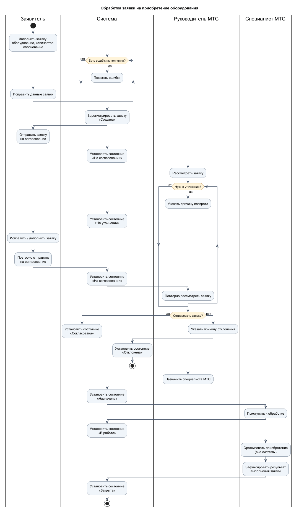

# Проектирование информационной системы учёта и обработки заявок на приобретение оборудования

## Введение

Проектирование программных систем является важным этапом разработки программного обеспечения, в ходе которого определяются состав компонентов, их взаимодействие и требования к будущему решению. Предварительное моделирование позволяет выявить неоднозначности в процессах и согласовать представление о системе до реализации программного кода.

В организациях потребность подразделений в оборудовании сопровождается подготовкой заявок, их согласованием и передачей ответственным специалистам. При отсутствии единого порядка учёта затрудняется определение текущего состояния заявки, ответственного исполнителя и результата её обработки. Для решения этих задач может применяться информационная система централизованного учёта заявок.

**Цель проекта** — спроектировать информационную систему учёта и обработки заявок на приобретение оборудования, разработать программный прототип и проверить его соответствие установленным требованиям.

**Объект исследования** — процесс формирования, согласования и исполнения заявок на приобретение оборудования для подразделений организации.

**Предмет исследования** — методы анализа предметной области, моделирования процессов, проектирования архитектуры и программной реализации средств учёта заявок.

Для достижения цели необходимо исследовать предметную область, определить границы автоматизации и участников, сформулировать требования, описать сценарии обработки заявок, построить UML-модели, выбрать архитектуру, реализовать прототип и выполнить его тестирование.

В качестве предметной области выбран **адаптированный вариант № 3** лабораторного практикума «Проектирование информационных систем», посвящённый учёту движения основных средств в отделе материально-технического снабжения (МТС). В отличие от исходного варианта, рассматриваемое учебное решение ограничено регистрацией, согласованием и учётом исполнения заявок **на приобретение** оборудования. Такое ограничение позволяет сосредоточиться на задачах проектирования и соответствует цели сквозного проекта из четырёх лабораторных работ по дисциплине «Проектирование и архитектура программных систем».

Для моделирования процессов и структуры системы используется UML в PlantUML. Реализация прототипа планируется на языке Python с разделением пользовательского интерфейса, бизнес-логики и доступа к данным.

## 1. Анализ предметной области и моделирование процессов

### 1.1. Описание предметной области и постановка задачи

**Цель этапа** — изучить процесс обработки заявок на приобретение оборудования, определить назначение и границы информационной системы, участников процесса, требования и сценарии её использования.

В рассматриваемой организации имеются подразделения, которым для выполнения производственных или административных задач требуется оборудование. При возникновении потребности сотрудник подразделения (заявитель) оформляет заявку, указывая необходимое оборудование, количество и обоснование приобретения.

Руководитель отдела МТС рассматривает заявку и выбирает одно из решений — согласовать, отклонить или возвратить на уточнение. Согласованная заявка назначается специалисту МТС. Специалист выполняет необходимые организационные действия вне информационной системы и фиксирует результат обработки. Заявитель может отслеживать состояние своей заявки и уточнять её по запросу руководителя.

Основные объекты предметной области — заявка, оборудование (включая категорию оборудования), пользователь, подразделение, назначенный исполнитель и состояние заявки. Сведения о заявке должны сохраняться и оставаться доступными для просмотра, поиска и контроля её исполнения.

В рамках учебного проекта **не выполняется автоматизация закупочной деятельности в полном объёме**. Финансовые расчёты, оформление бухгалтерских документов, взаимодействие с поставщиками и физическая передача оборудования остаются за пределами системы.

### 1.2. Назначение системы и границы автоматизации

**Назначение системы** — обеспечить единый порядок регистрации и контроля исполнения заявок на приобретение оборудования для подразделений организации.

В границы автоматизации входят:

1. Создание и регистрация заявки с необходимыми реквизитами.
2. Проверка корректности и полноты введённых данных.
3. Передача заявки на согласование руководителю МТС.
4. Согласование, отклонение или возврат заявки на уточнение.
5. Повторное направление исправленной заявки на согласование.
6. Назначение ответственного специалиста МТС.
7. Учёт состояния заявки и результата её обработки.
8. Просмотр, поиск и фильтрация зарегистрированных заявок.

За пределами автоматизации остаются выбор поставщика, заключение договора, закупка и оплата оборудования, ведение бухгалтерского и складского учёта, а также интеграции с внешними системами. Выполнение таких действий отмечается в системе ответственным специалистом вручную, без автоматизации самих внешних операций.

Разрабатываемая система является учебным прототипом. Она должна демонстрировать основные операции и корректное управление состояниями заявки, а не все функции реальной корпоративной системы закупок.

### 1.3. Участники системы и их обязанности

В процессе участвуют три категории пользователей. В таблице 1.1 представлены участники системы и их обязанности. На Activity-диаграмме дополнительно будет выделена дорожка «Система», представляющая автоматические действия программного решения, а не отдельную категорию пользователей.

**Таблица 1.1 — Участники системы и их обязанности**

| Участник | Обязанности |
| --- | --- |
| **Заявитель (сотрудник подразделения)** | Создаёт заявку, указывает сведения о потребности, направляет заявку на согласование, просматривает её состояние, исправляет и повторно отправляет заявку, возвращённую на уточнение. |
| **Руководитель МТС** | Рассматривает заявку, согласовывает или отклоняет её, возвращает на уточнение с объяснением причины, назначает ответственного специалиста и контролирует ход обработки. |
| **Специалист МТС** | Просматривает назначенные заявки, приступает к обработке, организует приобретение оборудования вне системы и фиксирует результат выполнения. |

В учебном прототипе для демонстрации указанных в таблице 1.1 обязанностей допускается выбор текущей роли без полноценной аутентификации. Проверка доступа к операциям может быть реализована на уровне бизнес-логики, разработка промышленной системы управления учётными записями в задачи проекта не входит.

### 1.4. Функциональные требования

Функциональные требования определяют действия, необходимые для регистрации, согласования и обработки заявок. В таблице 1.2 приведены функциональные требования к разрабатываемой информационной системе с уникальными идентификаторами, которые далее используются при моделировании и тестировании.

**Таблица 1.2 — Функциональные требования к информационной системе**

| Код | Требование |
| --- | --- |
| **FR-01** | Система должна позволять создавать заявку с указанием оборудования, категории, количества, обоснования приобретения, заявителя и подразделения. |
| **FR-02** | При регистрации корректно заполненной заявки система должна присваивать ей уникальный идентификатор, дату создания и начальное состояние **«Создана»**. |
| **FR-03** | Система должна предоставлять список зарегистрированных заявок и подробные сведения о выбранной заявке. |
| **FR-04** | Система должна обеспечивать поиск и фильтрацию заявок по состоянию, подразделению и категории оборудования. |
| **FR-05** | Заявитель должен иметь возможность направить созданную заявку на согласование, её состояние при этом изменяется на **«На согласовании»**. |
| **FR-06** | Руководитель МТС должен иметь возможность согласовать или отклонить заявку. При отклонении указание причины обязательно. |
| **FR-07** | Руководитель МТС должен иметь возможность вернуть заявку на уточнение с указанием причины возврата. |
| **FR-08** | Заявитель должен иметь возможность исправить заявку, находящуюся в состоянии **«На уточнении»**, и повторно отправить её на согласование без создания новой заявки. |
| **FR-09** | Руководитель МТС должен иметь возможность назначить ответственного специалиста для согласованной заявки. |
| **FR-10** | Назначенный специалист должен иметь возможность начать обработку заявки и после выполнения внешних организационных действий зафиксировать результат и закрыть заявку. |
| **FR-11** | Система должна разрешать только предусмотренные переходы между состояниями заявки, предотвращая недопустимые изменения. |

Требования FR-01—FR-05 описывают создание, регистрацию и передачу заявки на согласование, FR-06—FR-10 — её рассмотрение, назначение исполнителя и завершение обработки, FR-11 — контроль допустимых переходов между состояниями. Эти требования служат основой для последующих UML-моделей и реализации прототипа.

В модели процесса операция **«Зарегистрировать заявку»** включает присвоение идентификатора и даты создания по требованию FR-02. Эти технические реквизиты не показаны отдельными действиями UML, чтобы не перегружать диаграмму.

### 1.5. Нефункциональные требования

Помимо предусмотренных функций система должна удовлетворять требованиям к удобству использования, надёжности и качеству программной реализации. В таблице 1.3 приведены нефункциональные требования и способы их последующей проверки.

**Таблица 1.3 — Нефункциональные требования к информационной системе**

| Код | Атрибут качества | Требование и способ последующей проверки |
| --- | --- | --- |
| **NFR-01** | Удобство использования | Пользователь должен выполнять основные операции с заявками через графические формы, при некорректном вводе должны выводиться понятные сообщения об ошибках. Проверяется ручными тестовыми сценариями. |
| **NFR-02** | Надёжность хранения | При использовании постоянного хранилища данные заявок и результаты изменения их состояний должны сохраняться после штатного закрытия и повторного запуска программы. Проверяется повторным запуском прототипа. |
| **NFR-03** | Производительность | Для тестового набора до 1000 заявок отображение и фильтрация списка должны выполняться не более чем за 2 секунды на компьютере, используемом при испытании. Проверяется измерением времени выполнения. |
| **NFR-04** | Сопровождаемость | Интерфейс, бизнес-логика и доступ к данным должны быть разделены так, чтобы изменение способа хранения не требовало изменения правил обработки заявок. Проверяется анализом зависимостей компонентов. |
| **NFR-05** | Проверяемость | Основные операции с заявками и правила изменения состояний должны допускать автоматизированную проверку без запуска графического интерфейса. Проверяется тестами бизнес-логики. |

Эти требования являются **проектными критериями**, а не заявлениями о свойствах ещё не созданного программного прототипа. Фактические результаты проверки будут приведены в разделе, посвящённом тестированию и оценке архитектуры.

### 1.6. Сценарии обработки заявок

Для описания поведения информационной системы рассмотрены основной сценарий обработки заявки, два альтернативных сценария — отклонение и возврат на уточнение — и ситуация некорректного заполнения данных при создании заявки. В таблице 1.4 приведены условия выполнения этих сценариев и ожидаемые результаты.

**Таблица 1.4 — Сценарии обработки заявок на приобретение оборудования**

| Сценарий | Условия выполнения | Результат |
| --- | --- | --- |
| Основной — согласование и выполнение | Заявитель сформировал корректную заявку и направил её на согласование, руководитель принимает положительное решение. | Заявка переведена в состояние «Закрыта». |
| А1 — отклонение | Руководитель отклоняет заявку и указывает причину. | Заявка переведена в конечное состояние «Отклонена». |
| А2 — возврат на уточнение | Руководитель запрашивает уточнение сведений. | Заявитель исправляет исходную заявку и повторно направляет её на согласование. |
| Ошибка заполнения | Обязательные реквизиты отсутствуют или содержат некорректные значения. | Система отображает ошибку, заявка не регистрируется до исправления данных. |

Основной сценарий охватывает полный цикл обработки заявки — от её создания до закрытия. Предполагается, что заявитель и его подразделение определены, а сведения о требуемом оборудовании доступны. Последовательность действий включает следующие этапы:

1. Заявитель заполняет заявку, указывая оборудование, категорию, количество и обоснование приобретения.
2. Система проверяет обязательные данные. Если они корректны, заявка регистрируется с присвоением идентификатора, даты создания и состояния **«Создана»**.
3. Заявитель отправляет заявку на согласование. Система устанавливает состояние **«На согласовании»**.
4. Руководитель МТС рассматривает и согласовывает заявку. Система устанавливает состояние **«Согласована»**.
5. Руководитель назначает специалиста МТС. Система устанавливает состояние **«Назначена»**.
6. Специалист приступает к обработке. Система устанавливает состояние **«В работе»**.
7. Специалист организует приобретение оборудования **вне системы** и фиксирует результат обработки в системе.
8. Система устанавливает состояние **«Закрыта»**.

Таким образом, при успешном выполнении основного сценария заявка согласована, закреплена за ответственным специалистом и закрыта после фиксации результата её обработки.

При рассмотрении заявки руководителем на четвёртом этапе возможен **альтернативный сценарий А1 — отклонение**. Руководитель указывает причину отклонения, после чего система сохраняет её и устанавливает состояние **«Отклонена»**. Обработка заявки завершается без назначения специалиста и выполнения закупочных действий. Отклонённая заявка не направляется на повторное согласование, при возникновении новой потребности заявитель создаёт новую заявку.

Другой вариант решения руководителя — **альтернативный сценарий А2 — возврат на уточнение**. В этом случае руководитель указывает причину возврата, а система переводит заявку в состояние **«На уточнении»**. Заявитель изменяет данные существующей заявки и повторно отправляет её на согласование. Система устанавливает состояние **«На согласовании»**, после чего руководитель рассматривает исправленную заявку. Повторное рассмотрение может завершиться согласованием, отклонением либо очередным возвратом на уточнение. Новая заявка при этом не создаётся.

Отдельно предусмотрена **обработка некорректных данных при создании заявки**. Если обязательные сведения об оборудовании, его количестве или обосновании отсутствуют либо количество указано некорректно, система сообщает об ошибке. Заявитель исправляет введённые данные, после чего проверка выполняется повторно. До успешного прохождения проверки заявка **не регистрируется** и идентификатор ей не присваивается.

Для последующей разработки диаграммы состояний UML State Machine необходимо определить разрешённые изменения состояния заявки. В таблице 1.5 приведены допустимые переходы и события, которыми они инициируются.

**Таблица 1.5 — Допустимые переходы между состояниями заявки**

| Исходное состояние | Новое состояние | Основание перехода |
| --- | --- | --- |
| Создана | На согласовании | Заявитель отправил заявку. |
| На согласовании | Согласована | Руководитель согласовал заявку. |
| На согласовании | Отклонена | Руководитель отклонил заявку с указанием причины. |
| На согласовании | На уточнении | Руководитель вернул заявку на уточнение. |
| На уточнении | На согласовании | Заявитель исправил и повторно отправил заявку. |
| Согласована | Назначена | Руководитель назначил специалиста МТС. |
| Назначена | В работе | Специалист начал обработку. |
| В работе | Закрыта | Специалист зафиксировал результат выполнения. |

Перечисленные переходы определяют правила изменения состояния заявки для будущей диаграммы состояний и бизнес-логики программного прототипа. Состояния **«Отклонена»** и **«Закрыта»** являются конечными в рамках рассматриваемого процесса. Изменения состояния, не предусмотренные таблицей 1.5, должны отклоняться системой.

### 1.7. Моделирование процесса обработки заявки

В качестве модели ключевого процесса выбрана **диаграмма деятельности UML (Activity)** «Обработка заявки на приобретение оборудования», подготовленная в PlantUML. На рисунке 1.1 представлена последовательность действий участников процесса, включая основные решения и альтернативные варианты обработки заявки.

*Рисунок 1.1 — Диаграмма деятельности процесса обработки заявки на приобретение оборудования.*

[Редактируемый исходник диаграммы PlantUML](diagrams/activity/activity.puml).

На диаграмме представлены четыре дорожки ответственности — **«Заявитель»**, **«Система»**, **«Руководитель МТС»** и **«Специалист МТС»**. Первые, третья и четвёртая обозначают действия участников процесса, а дорожка «Система» — автоматические операции проверки данных, регистрации заявки и изменения её состояния.

Основной путь включает создание заявки, проверку обязательных полей, согласование, назначение специалиста, фиксацию выполнения и закрытие. Ветвления отражают ошибки ввода, возврат на уточнение и отклонение заявки. При возврате используется цикл повторного рассмотрения **той же заявки**, при отклонении процесс завершается. Приобретение оборудования отмечено как внешнее действие специалиста МТС, поскольку фактическая закупка не входит в границы автоматизации.

Диаграмма согласуется со сценариями подраздела 1.6 и требованиями FR-01—FR-11. Смена состояний на диаграмме является основой для дальнейшей UML State Machine и реализации проверки допустимых переходов в прототипе.

### 1.8. Результаты и выводы по этапу

На первом этапе проведён анализ предметной области учёта заявок на приобретение оборудования, определены назначение и границы автоматизации, выделены три категории пользователей и их обязанности.

Сформулированы **11 функциональных** и **5 нефункциональных** требований. Описаны основной сценарий обработки заявки, два альтернативных сценария (отклонение и возврат на уточнение) и ситуация некорректного ввода данных. Построена Activity-диаграмма, отражающая участников, последовательность действий, решения и циклы обработки.

Полученные модели определяют исходные данные для следующего этапа — построения UML Use Case, Class, State Machine и Sequence. В процессе последующей разработки необходимо обеспечить согласованность названий сущностей, операций и состояний с требованиями, сформулированными в настоящем разделе.

**Вывод** — поставленные задачи анализа предметной области и моделирования ключевого процесса выполнены на уровне проектной документации. Реализация и фактическая проверка работы прототипа будут представлены в следующих разделах.

## 2. UML-моделирование информационной системы

*Раздел будет дополнен при выполнении лабораторной работы № 2.*

## 3. Проектирование архитектуры и разработка прототипа

*Раздел будет дополнен при выполнении лабораторной работы № 3.*

## 4. Реализация, тестирование и оценка архитектуры

*Раздел будет дополнен при выполнении лабораторной работы № 4.*

## Заключение

*Общее заключение будет подготовлено после завершения всех четырёх лабораторных работ.*

## Список использованных источников

*Библиографические сведения будут оформлены при подготовке окончательной пояснительной записки. В качестве исходных учебных материалов использованы новый практикум по дисциплине «Проектирование и архитектура программных систем» и старый лабораторный практикум «Проектирование информационных систем» (вариант № 3).*
