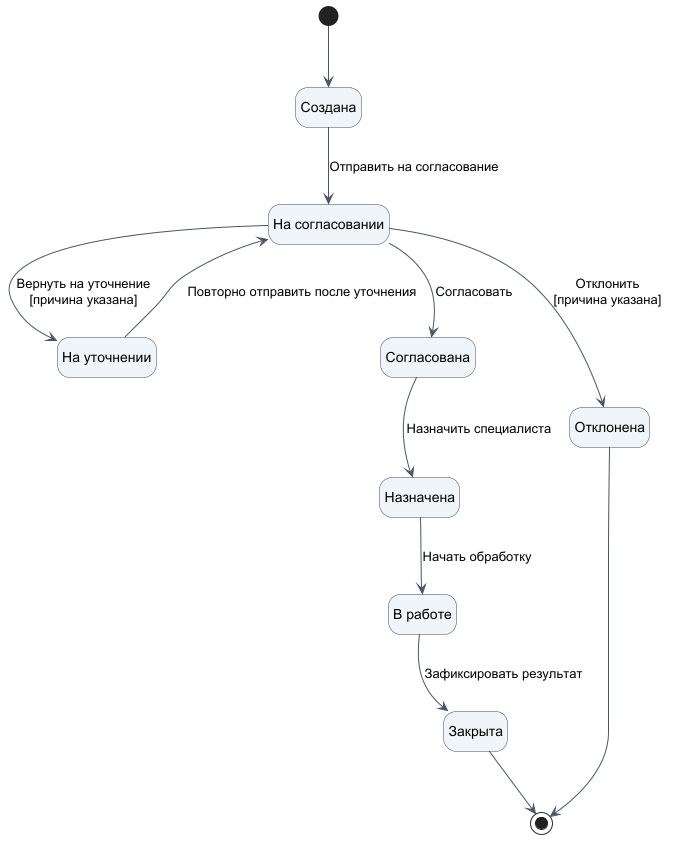
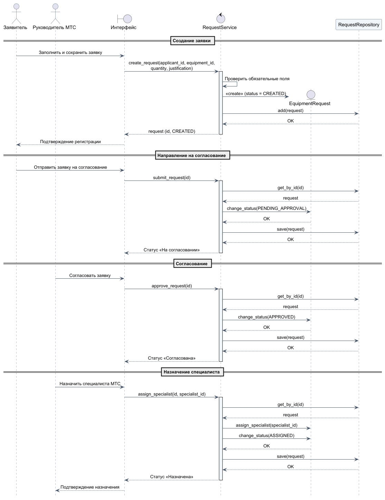
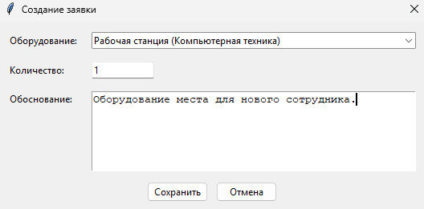
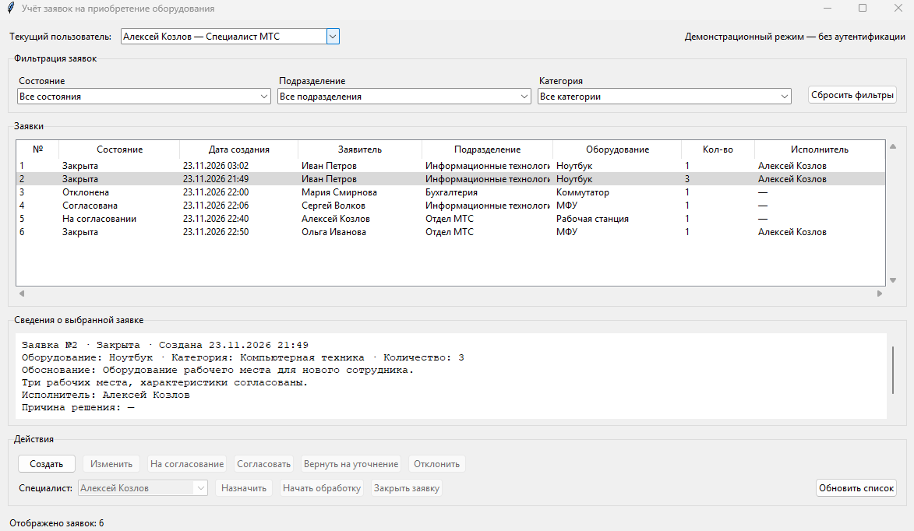

# Проектирование информационной системы учёта и обработки заявок на приобретение оборудования

## Введение

Проектирование программных систем является важным этапом разработки программного обеспечения, в ходе которого определяются состав компонентов, их взаимодействие и требования к будущему решению. Предварительное моделирование позволяет выявить неоднозначности в процессах и согласовать представление о системе до реализации программного кода.

В организациях потребность подразделений в оборудовании сопровождается подготовкой заявок, их согласованием и передачей ответственным специалистам. При отсутствии единого порядка учёта затрудняется определение текущего состояния заявки, ответственного исполнителя и результата её обработки. Для решения этих задач может применяться информационная система централизованного учёта заявок.

**Цель проекта** — спроектировать информационную систему учёта и обработки заявок на приобретение оборудования, разработать программный прототип и проверить его соответствие установленным требованиям.

**Объект исследования** — процесс формирования, согласования и исполнения заявок на приобретение оборудования для подразделений организации.

**Предмет исследования** — методы анализа предметной области, моделирования процессов, проектирования архитектуры и программной реализации средств учёта заявок.

Для достижения цели необходимо исследовать предметную область, определить границы автоматизации и участников, сформулировать требования, описать сценарии обработки заявок, построить UML-модели, выбрать архитектуру, реализовать прототип и выполнить его тестирование.

В качестве предметной области выбран **адаптированный вариант № 3** лабораторного практикума «Проектирование информационных систем», посвящённый учёту движения основных средств в отделе материально-технического снабжения (МТС). В отличие от исходного варианта, рассматриваемое учебное решение ограничено регистрацией, согласованием и учётом исполнения заявок **на приобретение** оборудования. Такое ограничение позволяет сосредоточиться на задачах проектирования и соответствует цели сквозного проекта из четырёх лабораторных работ по дисциплине «Проектирование и архитектура программных систем».

Для моделирования процессов и структуры системы используется UML в PlantUML. Реализация прототипа планируется на языке Python с разделением пользовательского интерфейса, бизнес-логики и доступа к данным.

## 1. Анализ предметной области и моделирование процессов

### 1.1. Описание предметной области и постановка задачи

**Цель этапа** — изучить процесс обработки заявок на приобретение оборудования, определить назначение и границы информационной системы, участников процесса, требования и сценарии её использования.

В рассматриваемой организации имеются подразделения, которым для выполнения производственных или административных задач требуется оборудование. При возникновении потребности сотрудник подразделения (заявитель) оформляет заявку, указывая необходимое оборудование, количество и обоснование приобретения.

Руководитель отдела МТС рассматривает заявку и выбирает одно из решений — согласовать, отклонить или возвратить на уточнение. Согласованная заявка назначается специалисту МТС. Специалист выполняет необходимые организационные действия вне информационной системы и фиксирует результат обработки. Заявитель может отслеживать состояние своей заявки и уточнять её по запросу руководителя.

Основные объекты предметной области — заявка, оборудование (включая категорию оборудования), пользователь, подразделение, назначенный исполнитель и состояние заявки. Сведения о заявке должны сохраняться и оставаться доступными для просмотра, поиска и контроля её исполнения.

В рамках учебного проекта **не выполняется автоматизация закупочной деятельности в полном объёме**. Финансовые расчёты, оформление бухгалтерских документов, взаимодействие с поставщиками и физическая передача оборудования остаются за пределами системы.

### 1.2. Назначение системы и границы автоматизации

**Назначение системы** — обеспечить единый порядок регистрации и контроля исполнения заявок на приобретение оборудования для подразделений организации.

В границы автоматизации входят:

1. Создание и регистрация заявки с необходимыми реквизитами.
2. Проверка корректности и полноты введённых данных.
3. Передача заявки на согласование руководителю МТС.
4. Согласование, отклонение или возврат заявки на уточнение.
5. Повторное направление исправленной заявки на согласование.
6. Назначение ответственного специалиста МТС.
7. Учёт состояния заявки и результата её обработки.
8. Просмотр, поиск и фильтрация зарегистрированных заявок.

За пределами автоматизации остаются выбор поставщика, заключение договора, закупка и оплата оборудования, ведение бухгалтерского и складского учёта, а также интеграции с внешними системами. Выполнение таких действий отмечается в системе ответственным специалистом вручную, без автоматизации самих внешних операций.

Разрабатываемая система является учебным прототипом. Она должна демонстрировать основные операции и корректное управление состояниями заявки, а не все функции реальной корпоративной системы закупок.

### 1.3. Участники системы и их обязанности

В информационной системе предусмотрены три роли пользователей — заявитель (сотрудник подразделения), руководитель МТС и специалист МТС. Роль определяет доступные пользователю операции и область просмотра зарегистрированных заявок. В таблице 1.1 представлены участники системы, их обязанности и область доступа к сведениям о заявках.

**Таблица 1.1 — Участники системы и их обязанности**

| Участник | Обязанности | Область просмотра заявок |
| --- | --- | --- |
| **Заявитель (сотрудник подразделения)** | Создаёт собственные заявки, указывает сведения о потребности, направляет заявки на согласование, при необходимости уточняет их и отслеживает ход обработки. | Заявки своего подразделения. |
| **Руководитель МТС** | Создаёт и направляет собственные заявки на согласование, рассматривает поступившие заявки, согласовывает, отклоняет или возвращает их на уточнение, назначает ответственных специалистов и контролирует ход обработки. | Заявки всех подразделений. |
| **Специалист МТС** | Создаёт и направляет собственные заявки на согласование, обрабатывает назначенные ему заявки, организует приобретение оборудования вне системы и фиксирует результат выполнения. | Заявки всех подразделений. |

Как следует из таблицы 1.1, создание заявки доступно каждому пользователю системы независимо от его должностной роли. В рамках конкретной заявки заявителем является сотрудник, создавший её. Изменять количество оборудования и обоснование приобретения, направлять заявку на согласование и повторно отправлять её после уточнения вправе только её заявитель. Редактирование допускается в состояниях «Создана» и «На уточнении».

Обычные сотрудники могут просматривать заявки своего подразделения независимо от того, кем они созданы. Такое ограничение обеспечивает доступ к сведениям о потребностях подразделения и ходе их обработки, не предоставляя доступа к заявкам других подразделений. Право просмотра чужой заявки не предоставляет права изменять её реквизиты или направлять её на согласование.

Руководитель и специалисты МТС имеют доступ к заявкам всех подразделений в связи с централизованной организацией процесса приобретения оборудования. Руководитель МТС является единственным уполномоченным лицом по согласованию заявок и вправе принимать решения в том числе по собственным заявкам. Все заявки проходят единый жизненный цикл независимо от должностной роли их инициатора. Начинать обработку и закрывать заявку вправе только назначенный специалист МТС.

В учебном прототипе допускается выбор текущего пользователя из демонстрационного справочника без полноценной аутентификации. Разграничение доступа к сведениям и операциям выполняется на уровне бизнес-логики с учётом роли, подразделения пользователя, принадлежности заявки и её текущего состояния. Разработка промышленной системы управления учётными записями и механизмов аутентификации в задачи проекта не входит.

На Activity-диаграмме дополнительно выделена дорожка «Система», представляющая автоматические действия программного решения, а не отдельную категорию пользователей.

### 1.4. Функциональные требования

Функциональные требования определяют действия, необходимые для регистрации, согласования и обработки заявок. В таблице 1.2 приведены функциональные требования к разрабатываемой информационной системе с уникальными идентификаторами, которые далее используются при моделировании и тестировании.

**Таблица 1.2 — Функциональные требования к информационной системе**

| Код | Требование |
| --- | --- |
| **FR-01** | Система должна позволять каждому пользователю создавать собственную заявку с указанием оборудования, количества и обоснования приобретения. Категория определяется по выбранному оборудованию, а заявитель и подразделение — по текущему пользователю. Обязательные данные должны проверяться, при некорректном вводе система должна сообщать об ошибке и не регистрировать заявку. |
| **FR-02** | При регистрации корректно заполненной заявки система должна присваивать ей уникальный идентификатор, дату создания и начальное состояние **«Создана»**. |
| **FR-03** | Система должна предоставлять список зарегистрированных заявок и подробные сведения о выбранной заявке. Обычным сотрудникам доступны заявки своего подразделения, руководителю и специалистам МТС — заявки всех подразделений. |
| **FR-04** | Система должна обеспечивать поиск и фильтрацию доступных пользователю заявок по состоянию, подразделению и категории оборудования с соблюдением установленных ограничений на просмотр. |
| **FR-05** | Каждый пользователь должен иметь возможность направить собственную созданную заявку на согласование. При выполнении операции состояние заявки изменяется на **«На согласовании»**. Направление чужой заявки на согласование запрещено. |
| **FR-06** | Руководитель МТС должен иметь возможность согласовать или отклонить заявку, находящуюся в состоянии **«На согласовании»**, в том числе собственную. При отклонении указание причины обязательно. |
| **FR-07** | Руководитель МТС должен иметь возможность вернуть заявку, находящуюся в состоянии **«На согласовании»**, на уточнение с указанием причины возврата. |
| **FR-08** | Каждый пользователь должен иметь возможность изменять количество оборудования и обоснование приобретения в собственной заявке, находящейся в состоянии **«Создана»** или **«На уточнении»**, а также повторно направлять заявку после возврата на уточнение на согласование без создания новой заявки. Редактирование чужих заявок и заявок в иных состояниях запрещено. |
| **FR-09** | Руководитель МТС должен иметь возможность назначить ответственного специалиста для согласованной заявки. |
| **FR-10** | Назначенный специалист должен иметь возможность начать обработку заявки и после выполнения внешних организационных действий зафиксировать результат и закрыть заявку. |
| **FR-11** | Система должна разрешать только предусмотренные переходы между состояниями заявки, предотвращая недопустимые изменения. |

Требования FR-01—FR-05 определяют порядок создания, регистрации, просмотра, фильтрации и передачи заявок на согласование, FR-06—FR-10 — порядок рассмотрения, уточнения, назначения исполнителя и завершения обработки, FR-11 — контроль допустимых переходов между состояниями. При выполнении операций должны соблюдаться полномочия пользователей, определённые в подразделе 1.3. Эти требования служат основой для последующих UML-моделей, реализации и тестирования прототипа.

В модели процесса операция **«Зарегистрировать заявку»** включает присвоение идентификатора и даты создания по требованию FR-02. Эти технические реквизиты не показаны отдельными действиями UML, чтобы не перегружать диаграмму.

### 1.5. Нефункциональные требования

Помимо предусмотренных функций система должна удовлетворять требованиям к удобству использования, надёжности и качеству программной реализации. В таблице 1.3 приведены нефункциональные требования и способы их последующей проверки.

**Таблица 1.3 — Нефункциональные требования к информационной системе**

| Код | Атрибут качества | Требование и способ последующей проверки |
| --- | --- | --- |
| **NFR-01** | Удобство использования | Пользователь должен выполнять основные операции с заявками через графические формы, при некорректном вводе должны выводиться понятные сообщения об ошибках. Проверяется ручными тестовыми сценариями. |
| **NFR-02** | Надёжность хранения | При использовании постоянного хранилища данные заявок и результаты изменения их состояний должны сохраняться после штатного закрытия и повторного запуска программы. Проверяется повторным запуском прототипа. |
| **NFR-03** | Производительность | Для тестового набора до 1000 заявок отображение и фильтрация списка должны выполняться не более чем за 2 секунды на компьютере, используемом при испытании. Проверяется измерением времени выполнения. |
| **NFR-04** | Сопровождаемость | Интерфейс, бизнес-логика и доступ к данным должны быть разделены так, чтобы изменение способа хранения не требовало изменения правил обработки заявок. Проверяется анализом зависимостей компонентов. |
| **NFR-05** | Проверяемость | Основные операции с заявками и правила изменения состояний должны допускать автоматизированную проверку без запуска графического интерфейса. Проверяется тестами бизнес-логики. |

Эти требования являются **проектными критериями**, а не заявлениями о свойствах ещё не созданного программного прототипа. Фактические результаты проверки будут приведены в разделе, посвящённом тестированию и оценке архитектуры.

### 1.6. Сценарии обработки заявок

Для описания поведения информационной системы рассмотрены основной сценарий обработки заявки, два альтернативных сценария — отклонение и возврат на уточнение — и ситуация некорректного заполнения данных при создании заявки. В таблице 1.4 приведены условия выполнения этих сценариев и ожидаемые результаты.

**Таблица 1.4 — Сценарии обработки заявок на приобретение оборудования**

| Сценарий | Условия выполнения | Результат |
| --- | --- | --- |
| Основной — согласование и выполнение | Заявитель сформировал корректную заявку и направил её на согласование, руководитель принимает положительное решение. | Заявка переведена в состояние «Закрыта». |
| А1 — отклонение | Руководитель отклоняет заявку и указывает причину. | Заявка переведена в конечное состояние «Отклонена». |
| А2 — возврат на уточнение | Руководитель запрашивает уточнение сведений. | Заявитель исправляет исходную заявку и повторно направляет её на согласование. |
| Ошибка заполнения | Обязательные реквизиты отсутствуют или содержат некорректные значения. | Система отображает ошибку, заявка не регистрируется до исправления данных. |

Основной сценарий охватывает полный цикл обработки заявки — от её создания до закрытия. Предполагается, что заявитель и его подразделение определены, а сведения о требуемом оборудовании доступны. Последовательность действий включает следующие этапы:

1. Заявитель заполняет заявку, указывая оборудование, количество и обоснование приобретения. Категория определяется по выбранному оборудованию, а заявитель и подразделение — по текущему пользователю системы.
2. Система проверяет обязательные данные. Если они корректны, заявка регистрируется с присвоением идентификатора, даты создания и состояния **«Создана»**.
3. Заявитель отправляет заявку на согласование. Система устанавливает состояние **«На согласовании»**.
4. Руководитель МТС рассматривает и согласовывает заявку. Система устанавливает состояние **«Согласована»**.
5. Руководитель назначает специалиста МТС. Система устанавливает состояние **«Назначена»**.
6. Специалист приступает к обработке. Система устанавливает состояние **«В работе»**.
7. Специалист организует приобретение оборудования **вне системы** и фиксирует результат обработки в системе.
8. Система устанавливает состояние **«Закрыта»**.

Таким образом, при успешном выполнении основного сценария заявка согласована, закреплена за ответственным специалистом и закрыта после фиксации результата её обработки.

При рассмотрении заявки руководителем на четвёртом этапе возможен **альтернативный сценарий А1 — отклонение**. Руководитель указывает причину отклонения, после чего система сохраняет её и устанавливает состояние **«Отклонена»**. Обработка заявки завершается без назначения специалиста и выполнения закупочных действий. Отклонённая заявка не направляется на повторное согласование, при возникновении новой потребности заявитель создаёт новую заявку.

Другой вариант решения руководителя — **альтернативный сценарий А2 — возврат на уточнение**. В этом случае руководитель указывает причину возврата, а система переводит заявку в состояние **«На уточнении»**. Заявитель изменяет данные существующей заявки и повторно отправляет её на согласование. Система устанавливает состояние **«На согласовании»**, после чего руководитель рассматривает исправленную заявку. Повторное рассмотрение может завершиться согласованием, отклонением либо очередным возвратом на уточнение. Новая заявка при этом не создаётся.

Отдельно предусмотрена **обработка некорректных данных при создании заявки**. Если обязательные сведения об оборудовании, его количестве или обосновании отсутствуют либо количество указано некорректно, система сообщает об ошибке. Заявитель исправляет введённые данные, после чего проверка выполняется повторно. До успешного прохождения проверки заявка **не регистрируется** и идентификатор ей не присваивается.

Для последующей разработки диаграммы состояний UML State Machine необходимо определить разрешённые изменения состояния заявки. В таблице 1.5 приведены допустимые переходы и события, которыми они инициируются.

**Таблица 1.5 — Допустимые переходы между состояниями заявки**

| Исходное состояние | Новое состояние | Основание перехода |
| --- | --- | --- |
| Создана | На согласовании | Заявитель отправил заявку. |
| На согласовании | Согласована | Руководитель согласовал заявку. |
| На согласовании | Отклонена | Руководитель отклонил заявку с указанием причины. |
| На согласовании | На уточнении | Руководитель вернул заявку на уточнение. |
| На уточнении | На согласовании | Заявитель исправил и повторно отправил заявку. |
| Согласована | Назначена | Руководитель назначил специалиста МТС. |
| Назначена | В работе | Специалист начал обработку. |
| В работе | Закрыта | Специалист зафиксировал результат выполнения. |

Перечисленные переходы определяют правила изменения состояния заявки для будущей диаграммы состояний и бизнес-логики программного прототипа. Состояния **«Отклонена»** и **«Закрыта»** являются конечными в рамках рассматриваемого процесса. Изменения состояния, не предусмотренные таблицей 1.5, должны отклоняться системой.

### 1.7. Моделирование процесса обработки заявки

В качестве модели ключевого процесса выбрана **диаграмма деятельности UML (Activity)** «Обработка заявки на приобретение оборудования», подготовленная в PlantUML. На рисунке 1.1 представлена последовательность действий участников процесса, включая основные решения и альтернативные варианты обработки заявки.


*Рисунок 1.1 — Диаграмма деятельности процесса обработки заявки на приобретение оборудования.*

[Редактируемый исходник диаграммы PlantUML](../diagrams/activity/activity.puml).

На диаграмме представлены четыре дорожки ответственности — **«Заявитель»**, **«Система»**, **«Руководитель МТС»** и **«Специалист МТС»**. Первые, третья и четвёртая обозначают действия участников процесса, а дорожка «Система» — автоматические операции проверки данных, регистрации заявки и изменения её состояния.

Дорожка «Заявитель» обозначает инициатора конкретной заявки независимо от его должностной роли. При создании собственной заявки в качестве заявителя могут выступать также руководитель и специалисты МТС.

Основной путь включает создание заявки, проверку обязательных полей, согласование, назначение специалиста, фиксацию выполнения и закрытие. Ветвления отражают ошибки ввода, возврат на уточнение и отклонение заявки. При возврате используется цикл повторного рассмотрения **той же заявки**, при отклонении процесс завершается. Приобретение оборудования отмечено как внешнее действие специалиста МТС, поскольку фактическая закупка не входит в границы автоматизации.

Диаграмма согласуется со сценариями подраздела 1.6 и требованиями FR-01—FR-11. Смена состояний на диаграмме является основой для дальнейшей UML State Machine и реализации проверки допустимых переходов в прототипе.

### 1.8. Результаты и выводы по этапу

На первом этапе проведён анализ предметной области учёта заявок на приобретение оборудования, определены назначение и границы автоматизации, выделены три категории пользователей и их обязанности.

Сформулированы **11 функциональных** и **5 нефункциональных** требований. Описаны основной сценарий обработки заявки, два альтернативных сценария (отклонение и возврат на уточнение) и ситуация некорректного ввода данных. Построена Activity-диаграмма, отражающая участников, последовательность действий, решения и циклы обработки.

Полученные модели определяют исходные данные для следующего этапа — построения UML Use Case, Class, State Machine и Sequence. В процессе последующей разработки необходимо обеспечить согласованность названий сущностей, операций и состояний с требованиями, сформулированными в настоящем разделе.

**Вывод** — поставленные задачи анализа предметной области и моделирования ключевого процесса выполнены на уровне проектной документации. Реализация и фактическая проверка работы прототипа будут представлены в следующих разделах.

## 2. UML-моделирование информационной системы

**Цель этапа** — разработать UML-модели, отражающие функциональные возможности, статическую структуру и динамику информационной системы учёта заявок на приобретение оборудования, и обеспечить их согласованность с требованиями и сценариями раздела 1.

### 2.1. Диаграмма вариантов использования

Диаграмма вариантов использования (Use Case) определяет функции, доступные пользователям системы, и показывает взаимодействие внешних участников с проектируемым программным решением. На рисунке 2.1 представлена диаграмма вариантов использования информационной системы учёта заявок на приобретение оборудования.


*Рисунок 2.1 — Диаграмма вариантов использования системы учёта заявок на приобретение оборудования*

На диаграмме представлены три основные роли — заявитель, руководитель МТС и специалист МТС. Для общих действий введён обобщённый актор «Пользователь системы», от которого наследуются указанные роли. Обобщённый актор не обозначает отдельную категорию пользователей, а позволяет определить общий набор функций без дублирования связей с вариантами использования.

Всем пользователям доступны просмотр и фильтрация заявок, создание собственных заявок, их редактирование и отправка на согласование. При этом область просмотра определяется ролью и подразделением пользователя. Обычные сотрудники могут просматривать заявки своего подразделения, а руководитель и специалисты МТС — заявки всех подразделений.

Редактирование допускается только для собственных заявок, находящихся в состояниях «Создана» и «На уточнении». Первичная и повторная отправка на согласование представлены одним вариантом использования, поскольку выполняются посредством одной операции.

Руководитель МТС обладает дополнительными полномочиями — согласовывает или отклоняет заявки, возвращает их на уточнение и назначает ответственных специалистов. Указанные полномочия распространяются в том числе на заявки, созданные руководителем лично. Специалист МТС может начать обработку назначенной ему заявки, зафиксировать результат и завершить её выполнение.

Обязательная проверка данных представлена отношениями `<<include>>` при создании и редактировании заявки. Проверка введённых сведений рассматривается как неотъемлемая часть этих операций и не требует самостоятельного действия пользователя.

Таким образом, диаграмма отражает функциональные требования FR-01—FR-11, определённые в таблице 1.2, с учётом разграничения полномочий пользователей. Допустимая последовательность выполнения операций определяется моделью состояний заявки, рассмотренной в подразделе 2.4.

### 2.2. Диаграмма классов

Для описания статической структуры системы разработана диаграмма классов (Class), представленная на рисунке 2.2. Она содержит основные классы предметной области, сервис обработки заявок, абстрактный класс репозитория и его реализацию для SQLite. Классы сгруппированы в три пакета — «Предметная область», «Бизнес-логика» и «Доступ к данным».


*Рисунок 2.2 — Диаграмма классов информационной системы учёта заявок на приобретение оборудования*

Основные классы диаграммы и их назначение приведены в таблице 2.1.

**Таблица 2.1 — Основные классы информационной системы**

| Элемент | Назначение |
| --- | --- |
| `Department` | Хранение сведений о подразделении организации. |
| `User` | Представление пользователя, его роли и принадлежности к подразделению. |
| `EquipmentCategory` | Описание категории оборудования. |
| `Equipment` | Хранение сведений об оборудовании и его принадлежности к категории. |
| `EquipmentRequest` | Хранение реквизитов заявки, её состояния, назначенного специалиста, причины решения руководителя и результата обработки, контроль допустимых переходов состояния. |
| `RequestService` | Координация бизнес-операций, проверка полномочий пользователя, получение и сохранение заявок через репозиторий. |
| `RequestRepository` | Определение абстрактного контракта добавления, получения, перечисления и сохранения заявок независимо от конкретного хранилища. |
| `SQLiteRequestRepository` | Реализация операций репозитория с использованием локальной базы данных SQLite. |

Класс `EquipmentRequest` является центральной сущностью модели. С заявкой связаны заявитель, необязательный назначенный исполнитель, подразделение и оборудование. Ассоциации снабжены кратностями, позволяющими определить количество связанных объектов. Каждая заявка относится к одному заявителю, одному подразделению и одной позиции оборудования. Пользователь может создать несколько заявок, а исполнитель может отсутствовать до назначения специалиста.

В программной модели указанные отношения представлены идентификаторами связанных объектов. Атрибут `User.department_id` определяет принадлежность пользователя к подразделению, а `Equipment.category_id` — принадлежность оборудования к категории. В классе `EquipmentRequest` предусмотрены атрибуты `applicant_id`, `department_id`, `equipment_id` и `assigned_specialist_id`. Ассоциации на диаграмме отражают логические отношения предметной области, а идентификаторы — способ их представления в программном коде.

Перечисление `UserRole` определяет допустимые роли пользователей (`APPLICANT`, `MANAGER`, `SPECIALIST`), а `RequestStatus` — восемь состояний заявки. Зависимости от перечислений согласованы с типами атрибутов `User.role` и `EquipmentRequest.status`. Атрибуты `assigned_specialist_id`, `decision_reason` и `completion_result` допускают отсутствие значения (`None`), поскольку соответствующие сведения появляются на разных этапах обработки заявки.

Метод `EquipmentRequest.update_details()` изменяет количество оборудования и обоснование приобретения, `assign_specialist()` устанавливает идентификатор исполнителя, `can_transition_to()` проверяет допустимость перехода между состояниями, а `change_status()` выполняет изменение состояния с проверкой необходимых условий.

Класс `RequestService` предоставляет публичные операции создания, редактирования, согласования, назначения, обработки, получения и фильтрации заявок. Через конструктор сервис получает репозиторий, текущего пользователя и справочные данные пользователей и оборудования. Перед выполнением операций сервис проверяет полномочия текущего пользователя, а при просмотре и фильтрации учитывает доступную ему область заявок. Необязательные параметры метода `filter_requests()` позволяют применять отдельные критерии или их сочетания.

`RequestRepository` представлен абстрактным классом, определяющим операции `add()`, `get_by_id()`, `list_all()` и `save()`. Класс `SQLiteRequestRepository` наследуется от него и реализует эти операции для конкретного хранилища. Сервис зависит от абстрактного контракта, а экземпляр репозитория передаётся ему извне через конструктор. Такая организация отделяет правила обработки заявок от способа их хранения.

Диаграмма уточнена по результатам разработки прототипа — отражены фактически используемые идентификаторы, типы данных, публичные операции и реализация репозитория. Вспомогательные методы и классы графического интерфейса не представлены, поскольку диаграмма предназначена для описания основных классов предметной области, бизнес-логики и доступа к данным. Программная реализация этих компонентов рассматривается в разделе 3.

### 2.3. Диаграмма деятельности

Динамика обработки заявки ранее представлена диаграммой деятельности (Activity) на рисунке 1.1. Она используется также в настоящем этапе, поскольку построена на основе тех же участников и требований.

Диаграмма охватывает регистрацию заявки, проверку введённых данных, передачу на согласование, рассмотрение руководителем, назначение специалиста и завершение обработки. Предусмотрены альтернативные пути отклонения и возврата на уточнение. Дорожка «Система» отделяет автоматические действия приложения от действий пользователей.

Дорожка «Заявитель» обозначает инициатора конкретной заявки, а не исключительно пользователя с ролью `APPLICANT`. В этой части процесса могут участвовать также руководитель и специалисты МТС при создании собственных заявок. Полномочия руководителя и специалиста при рассмотрении и исполнении заявок определяются их должностными ролями.

Повторное построение Activity-диаграммы не требуется. Сценарии из подраздела 1.6 и модель на рисунке 1.1 используются как общая основа для проверки остальных UML-диаграмм.

### 2.4. Диаграмма состояний заявки

Для формализации жизненного цикла объекта `EquipmentRequest` построена диаграмма состояний (State Machine), представленная на рисунке 2.3. Она основана на допустимых переходах, указанных в таблице 1.5.



*Рисунок 2.3 — Диаграмма состояний заявки на приобретение оборудования*

После регистрации заявка находится в состоянии «Создана», затем может быть направлена на согласование. Руководитель согласовывает её, отклоняет с указанием причины либо возвращает на уточнение. В последнем случае заявитель исправляет сведения и повторно отправляет ту же заявку на согласование.

После согласования и назначения специалиста заявка последовательно переходит в состояния «Назначена» и «В работе». Фиксация результата выполнения переводит её в состояние «Закрыта». Состояния «Отклонена» и «Закрыта» завершают соответствующие ветви процесса.

Диаграмма определяет разрешённые изменения состояния. В прототипе контроль допустимости переходов осуществляется методами `can_transition_to()` и `change_status()` класса `EquipmentRequest`, а проверка полномочий пользователя — в `RequestService`. Жизненный цикл един для всех заявок независимо от должностной роли их инициатора. Результаты проверки указанных правил будут представлены в разделе 4.

### 2.5. Диаграмма последовательности

Для детализации взаимодействия компонентов при создании и назначении заявки разработана диаграмма последовательности (Sequence), представленная на рисунке 2.4.



*Рисунок 2.4 — Диаграмма последовательности создания и назначения заявки на приобретение оборудования*

На диаграмме участвуют заявитель, руководитель МТС, пользовательский интерфейс, `RequestService`, объект `EquipmentRequest` и `RequestRepository`. Основной сценарий разделён на четыре последовательных этапа — создание заявки, направление на согласование, согласование и назначение специалиста. Под заявителем понимается инициатор заявки независимо от его должностной роли.

При создании заявки интерфейс вызывает `RequestService.create_request()`. Сервис проверяет принадлежность идентификатора заявителя текущему пользователю и наличие оборудования в справочнике, создаёт объект `EquipmentRequest` в состоянии `CREATED` и передаёт его в репозиторий для сохранения. Проверка количества и обоснования выполняется в предметной модели при создании объекта. На диаграмме проверки обобщены без детализации внутренних вызовов.

При передаче заявки на согласование и положительном решении руководителя сервис получает заявку из репозитория, проверяет полномочия пользователя, вызывает метод `change_status()` с соответствующим значением `RequestStatus` и сохраняет изменения.

На этапе назначения руководитель инициирует `RequestService.assign_specialist()`. Сервис проверяет роль текущего пользователя и выбранного исполнителя, получает заявку, вызывает `EquipmentRequest.assign_specialist(specialist_id)`, устанавливает состояние `ASSIGNED` и сохраняет изменённый объект. Эта последовательность соответствует атрибутам и операциям UML Class.

Условные ответы `OK` на диаграмме обозначают успешное завершение операции, а не конкретные возвращаемые значения методов Python. Диаграмма показывает основной успешный путь. Альтернативные ситуации отклонения и возврата на уточнение уже определены диаграммами Activity и State Machine, поэтому здесь повторно не рассматриваются.

### 2.6. Проверка согласованности моделей и выводы

В ходе проектирования проверено соответствие UML-моделей требованиям и сценариям первого этапа. После разработки прототипа диаграммы Use Case и Class актуализированы с учётом уточнённых полномочий пользователей и фактической структуры программного кода. В таблице 2.2 приведены основные связи между моделями.

**Таблица 2.2 — Согласованность UML-моделей**

| Модель | Что отражает | Связь с остальными моделями |
| --- | --- | --- |
| Use Case | Общие и специализированные функции пользователей | Основана на ролях, области доступа и требованиях FR-01—FR-11. |
| Class | Структура данных, операции и связи классов | Определяет классы и методы, используемые в Sequence, и соответствует основным компонентам реализованного прототипа. |
| Activity | Общий порядок обработки заявки и альтернативные сценарии | Согласована со сценариями подраздела 1.6 и состояниями заявки. |
| State Machine | Допустимые состояния и переходы объекта `EquipmentRequest` | Соответствует перечислению `RequestStatus`, таблице 1.5 и правилам предметной модели. |
| Sequence | Взаимодействие компонентов при создании и назначении заявки | Использует публичные операции `RequestService`, `EquipmentRequest` и `RequestRepository`, определённые в Class. |

По результатам сопоставления установлено, что основные участники, операции и состояния заявок согласованы между моделями. Например, назначение специалиста представлено действием руководителя МТС в Use Case, бизнес-операцией `RequestService.assign_specialist()` и вызовом метода `EquipmentRequest.assign_specialist()` на диаграмме последовательности. Состояние `ASSIGNED` соответствует следующему этапу жизненного цикла заявки.

Уточнение правил доступа потребовало изменения диаграммы Use Case, поскольку создание, редактирование и отправка собственных заявок доступны всем категориям пользователей. Диаграмма Class уточнена в соответствии с реализованными атрибутами, операциями и зависимостями классов. Диаграммы Activity, State Machine и Sequence сохраняют применимость — порядок обработки заявки, допустимые состояния и основные операции остались прежними.

Таким образом, разработаны пять предусмотренных заданием UML-моделей — Use Case, Class, Activity, State Machine и Sequence. Они описывают функциональные возможности, статическую структуру и динамику системы и согласованы с архитектурными моделями и программным прототипом, представленными в разделе 3. Подтверждение работоспособности реализованных операций и оценка архитектуры выполняются в разделе 4.

## 3. Проектирование архитектуры и разработка прототипа

**Цель этапа** — выбрать архитектурный стиль информационной системы, определить ответственность программных компонентов и их интерфейсы, представить архитектуру на UML-диаграммах Component и Deployment и реализовать работающий прототип учёта заявок на приобретение оборудования.

В качестве исходных данных использованы функциональные и нефункциональные требования раздела 1, а также UML-модели, разработанные в разделе 2. Прототип реализован на Python с графическим интерфейсом Tkinter и локальным хранилищем SQLite.

### 3.1. Выбор архитектурного стиля

Для учебной системы выбрана **слоистая архитектура** с разделением пользовательского интерфейса, бизнес-логики и доступа к данным. Приложение реализовано как локальная программа, выполняемая на одном компьютере, выделенный сервер приложений и сетевой обмен между компонентами не используются.

Выбор слоистой архитектуры обусловлен характером решаемой задачи. Пользовательский интерфейс отвечает за ввод и отображение сведений, бизнес-логика — за выполнение операций и соблюдение правил обработки заявок, слой доступа к данным — за сохранение объектов независимо от их представления на экране. Такое разделение упрощает сопровождение и позволяет проверять основные правила без запуска графического интерфейса.

Внутри слоя бизнес-логики отдельно выделена предметная модель. Класс `EquipmentRequest` содержит данные заявки и правила изменения её состояния, тогда как `RequestService` проверяет полномочия пользователя и координирует выполнение операций. Для обращения к хранилищу сервис использует абстрактный интерфейс `RequestRepository`, а не конкретные SQL-запросы. Это обеспечивает независимость бизнес-логики от выбранного способа хранения в пределах установленного интерфейса.

Архитектура соответствует масштабам прототипа и не требует разработки дополнительных сетевых сервисов. Возможности её развития и ограничения будут рассмотрены в разделе 4 при оценке сценариев изменения требований.

### 3.2. Компонентная структура и размещение системы

Для представления основных программных частей и зависимостей между ними разработана диаграмма компонентов (Component), приведённая на рисунке 3.1.


*Рисунок 3.1 — Диаграмма компонентов информационной системы учёта заявок на приобретение оборудования*

Диаграмма отражает взаимодействие `Tkinter UI`, `RequestService`, моделей предметной области и компонентов хранения. Интерфейс `RequestRepository` задаёт общий контракт доступа к заявкам, компонент `SQLiteRequestRepository` реализует этот контракт и взаимодействует с локальной базой данных посредством модуля `sqlite3`. Таким образом, пользовательские действия проходят через сервисный слой, а программный код предметной области не содержит SQL-запросов.

Ответственность компонентов и их соответствие модулям Python представлены в таблице 3.1.

**Таблица 3.1 — Назначение компонентов программного прототипа**

| Логическая часть | Основные модули | Ответственность |
| --- | --- | --- |
| Пользовательский интерфейс | [`ui/app.py`](../../src/equipment_requests/ui/app.py) | Отображение заявок, формы ввода, фильтры и вызов операций сервиса. |
| Предметная область | [`domain/enums.py`](../../src/equipment_requests/domain/enums.py), [`domain/models.py`](../../src/equipment_requests/domain/models.py) | Пользователи, подразделения, оборудование, заявка и допустимые переходы состояний. |
| Бизнес-логика | [`services/request_service.py`](../../src/equipment_requests/services/request_service.py) | Проверка полномочий, регистрация, согласование, назначение, закрытие и поиск заявок. |
| Доступ к данным | [`repositories/base.py`](../../src/equipment_requests/repositories/base.py), [`repositories/sqlite_repository.py`](../../src/equipment_requests/repositories/sqlite_repository.py) | Контракт хранения и реализация операций с SQLite. |
| Сборка и запуск | [`bootstrap.py`](../../src/equipment_requests/bootstrap.py), [`data/reference_data.py`](../../src/equipment_requests/data/reference_data.py), [`__main__.py`](../../src/equipment_requests/__main__.py) | Создание компонентов, демонстрационные справочники и точка входа. |

Представленное разделение определяет структуру каталога `src/equipment_requests/`. Ссылки в таблице 3.1 ведут непосредственно к исходным файлам соответствующих компонентов в репозитории.

Физическое размещение приложения представлено диаграммой развёртывания (Deployment) на рисунке 3.2.


*Рисунок 3.2 — Диаграмма развёртывания информационной системы учёта заявок на приобретение оборудования*

В рассматриваемой конфигурации пользователь работает на компьютере под управлением Windows. Приложение `equipment_requests` выполняется в среде Python 3.14 и включает графический интерфейс, сервис обработки заявок, модели предметной области и SQLite-репозиторий. Данные заявок сохраняются в локальном файле `requests.db`. Выделенный сервер базы данных не требуется.

### 3.3. Пользовательский интерфейс

Пользовательский интерфейс реализован средствами стандартной библиотеки Tkinter. Основная форма содержит выбор демонстрационного пользователя, фильтры по состоянию, подразделению и категории оборудования, таблицу зарегистрированных заявок, сведения о выбранной заявке и кнопки выполнения доступных операций. Общий вид приложения представлен на рисунке 3.3.


*Рисунок 3.3 — Главное окно прототипа со списком заявок и средствами фильтрации*

В прототипе пользователь выбирается из демонстрационного справочника. Полноценная аутентификация не реализована, переключение пользователя служит только для демонстрации ролевых сценариев и не обеспечивает защиту реальной информационной системы. При этом `RequestService` проверяет полномочия выбранного пользователя. Обычным сотрудникам доступны для просмотра заявки их подразделения, руководителю и специалистам МТС — заявки всех подразделений. Создавать заявки могут все пользователи, изменять и отправлять на согласование разрешается только собственные заявки.

Создание заявки выполняется в отдельной форме, где пользователь выбирает оборудование, указывает количество и обоснование приобретения. Пример формы приведён на рисунке 3.4.



*Рисунок 3.4 — Форма создания заявки на приобретение оборудования*

После успешного ввода данных интерфейс вызывает `RequestService.create_request()`. Заявке присваивается идентификатор, дата создания и начальное состояние `CREATED`. Отправка на согласование выполняется отдельным действием. Ошибки заполнения обязательных полей отображаются пользователю в диалоговом окне.

Для руководителя МТС предусмотрены согласование, отклонение, возврат на уточнение и назначение специалиста. После согласования заявки руководитель выбирает исполнителя из демонстрационного справочника. Соответствующий этап работы представлен на рисунке 3.5.


*Рисунок 3.5 — Назначение специалиста МТС для согласованной заявки*

Назначенный специалист может начать обработку и закрыть заявку после внесения результата. Для ввода причин отклонения, возврата на уточнение и результата обработки используются многострочные текстовые поля. Пример закрытой заявки с сохранённым результатом показан на рисунке 3.6.



*Рисунок 3.6 — Закрытая заявка с назначенным исполнителем и результатом обработки*

Доступность кнопок зависит от роли пользователя и состояния выбранной заявки. Эти ограничения отображения не заменяют проверок в сервисном слое — прямой вызов его методов также проходит контроль полномочий и допустимости операции. Реализация интерфейса сосредоточена в модуле [`ui/app.py`](../../src/equipment_requests/ui/app.py).

### 3.4. Предметная область и бизнес-логика

Предметная область реализована в модулях [`domain/enums.py`](../../src/equipment_requests/domain/enums.py) и [`domain/models.py`](../../src/equipment_requests/domain/models.py). Для описания данных используются классы `dataclass`, а роли пользователей и состояния заявок представлены перечислениями `UserRole` и `RequestStatus`. Центральным объектом является `EquipmentRequest`, содержащий идентификаторы заявителя, подразделения и оборудования, количество, обоснование, дату создания, состояние, назначенного специалиста и сведения о результате обработки.

Методы `EquipmentRequest.update_details()`, `assign_specialist()`, `can_transition_to()` и `change_status()` реализуют правила изменения данных и переходы между состояниями, заданные диаграммой State Machine (рисунок 2.3). Например, назначение специалиста допускается только после согласования заявки, а переход в состояние `CLOSED` требует указания результата выполнения. Недопустимые переходы приводят к ошибке и не сохраняются как завершённая операция.

Класс [`RequestService`](../../src/equipment_requests/services/request_service.py) предоставляет операции, необходимые для выполнения пользовательских сценариев. Основные публичные методы приведены в таблице 3.2.

**Таблица 3.2 — Основные публичные операции сервиса обработки заявок**

| Операция | Назначение |
| --- | --- |
| `create_request()`, `update_request()` | Регистрация и изменение собственной заявки. |
| `submit_request()` | Направление созданной или уточнённой заявки на согласование. |
| `approve_request()`, `reject_request()`, `request_clarification()` | Принятие решения руководителем МТС. |
| `assign_specialist()` | Назначение исполнителя по согласованной заявке. |
| `start_processing()`, `close_request()` | Начало обработки и фиксация результата специалистом. |
| `get_request()`, `filter_requests()` | Получение сведений и отбор заявок с учётом прав просмотра. |

При выполнении операций сервис определяет текущего пользователя, проверяет его должностные полномочия и при необходимости принадлежность заявки. Для сотрудников, не относящихся к руководству и специалистам МТС, просмотр ограничен собственным подразделением. Изменение и отправка на согласование чужой заявки запрещены независимо от её видимости в списке. Руководитель МТС является единственным согласующим лицом в моделируемой организации и вправе согласовывать также собственные заявки. Обработку и закрытие выполняет только назначенный специалист.

`RequestService` не реализует хранение самостоятельно, он получает объект заявки через интерфейс `RequestRepository`, применяет правила предметной области и передаёт изменённые данные на сохранение. Реализация предметной модели и сервиса доступна по ссылкам на соответствующие модули репозитория.

### 3.5. Доступ к данным

Для постоянного хранения заявок используется SQLite, работа с которой выполняется стандартным модулем Python `sqlite3`. В модуле [`repositories/base.py`](../../src/equipment_requests/repositories/base.py) определён абстрактный класс `RequestRepository` с методами `add()`, `get_by_id()`, `list_all()` и `save()`. Он представляет контракт, от которого зависит сервис обработки заявок.

Модуль [`repositories/sqlite_repository.py`](../../src/equipment_requests/repositories/sqlite_repository.py) содержит класс `SQLiteRequestRepository`, реализующий указанные операции. При первом подключении создаётся таблица `requests`, если она ещё отсутствует. Для каждой заявки сохраняются основные реквизиты, состояние, назначенный исполнитель, причина решения руководителя и результат выполнения. При добавлении записи база присваивает уникальный идентификатор, при чтении данные преобразуются обратно в объект `EquipmentRequest`.

Для выполнения операций записи применяются параметризованные SQL-запросы. После завершения транзакции сведения остаются в локальном файле `requests.db` и могут быть загружены при следующем запуске приложения. Таким образом, в отличие от допустимого по заданию хранения объектов только в памяти, разработанный прототип обеспечивает постоянное хранение заявок.

Сведения о пользователях, подразделениях, категориях и оборудовании представлены фиксированными демонстрационными наборами в модуле [`data/reference_data.py`](../../src/equipment_requests/data/reference_data.py). Их администрирование и изменение через интерфейс в границы прототипа не входят. Реализация доступа к данным и демонстрационных справочников доступна по ссылкам на соответствующие файлы.

### 3.6. Сборка компонентов и запуск прототипа

Сборка компонентов вынесена в модуль [`bootstrap.py`](../../src/equipment_requests/bootstrap.py). Функция `create_repository()` создаёт экземпляр `SQLiteRequestRepository`, а `create_service()` формирует `RequestService` для выбранного демонстрационного пользователя, передавая ему репозиторий и справочные данные. При переключении пользователей используется общее хранилище заявок.

Точкой входа является модуль [`__main__.py`](../../src/equipment_requests/__main__.py), который создаёт приложение `EquipmentRequestsApp` и запускает цикл обработки событий Tkinter. Для запуска из корня проекта используются команды:

```powershell
uv sync
uv run python -m equipment_requests
```

Для разработки используется Python 3.14 и управление окружением через `uv`. Сторонние библиотеки для графического интерфейса, SQLite и базового тестирования не требуются, поскольку Tkinter, `sqlite3` и `unittest` входят в стандартную библиотеку Python. Конфигурация проекта определена файлом `pyproject.toml`.

Исходные UML-модели подготовлены в PlantUML. Генерация программного кода из диаграмм не применялась. Классы и модули реализованы вручную в соответствии с согласованной структурой, интерфейсами и сценариями. Такой способ позволил отдельно реализовать проверки состояний, разграничение полномочий и преобразование данных SQLite.

### 3.7. Результаты этапа и выводы

В ходе третьего этапа обоснована слоистая архитектура локальной информационной системы, определены компоненты и зависимости между ними, разработаны UML-диаграммы Component и Deployment. Реализован прототип с графическим интерфейсом, сервисом обработки заявок, предметной моделью и постоянным хранением в SQLite.

Прототип предоставляет создание и просмотр заявок, отправку на согласование, принятие решений руководителем МТС, назначение специалиста, начало обработки, фиксацию результата и закрытие. Предусмотрены возврат на уточнение, отклонение, фильтрация и разграничение полномочий. В ходе ручной проверки был выполнен основной процесс обработки заявки, в том числе проверено сохранение закрытой заявки после перезапуска приложения.

Таким образом, разработанный прототип демонстрирует предусмотренное заданием разделение логических частей и выполнение основных операций. Подробные тестовые сценарии, результаты автоматизированных проверок, анализ архитектурных изменений и выявленных ограничений будут представлены в разделе 4.

## 4. Реализация, тестирование и оценка архитектуры

*Раздел будет дополнен при выполнении лабораторной работы № 4.*

## Заключение

*Общее заключение будет подготовлено после завершения всех четырёх лабораторных работ.*

## Список использованных источников

*Библиографические сведения будут оформлены при подготовке окончательной пояснительной записки. В качестве исходных учебных материалов использованы новый практикум по дисциплине «Проектирование и архитектура программных систем» и старый лабораторный практикум «Проектирование информационных систем» (вариант № 3).*
