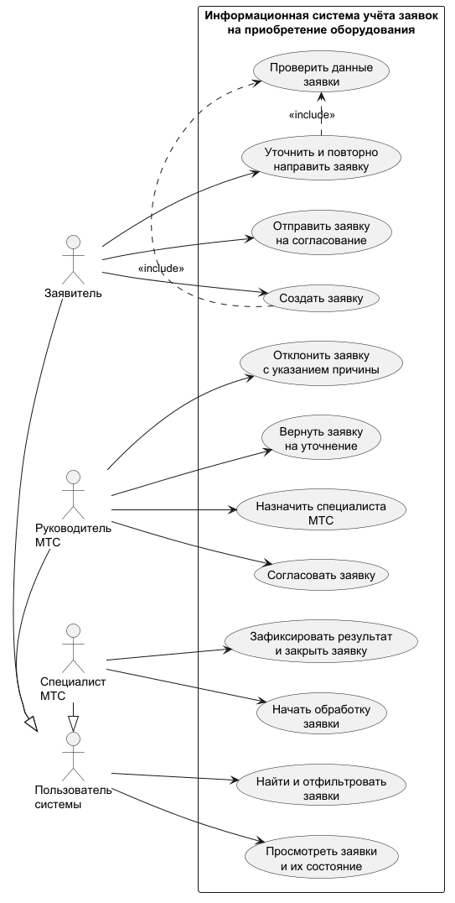
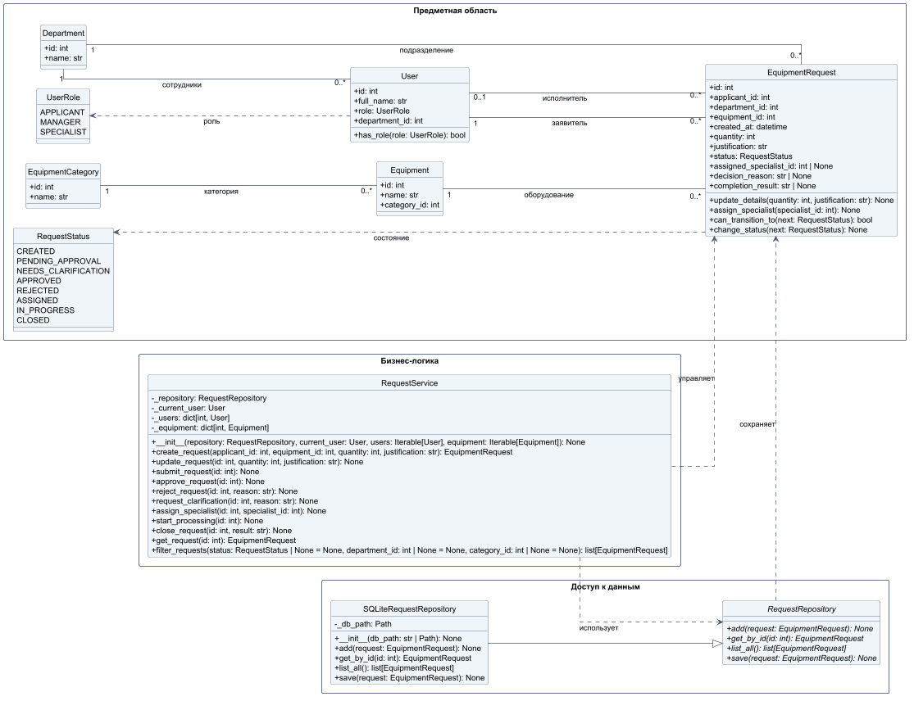
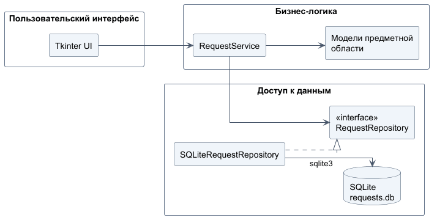
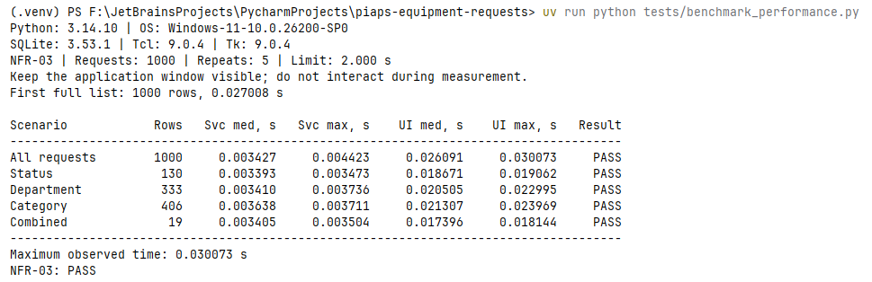
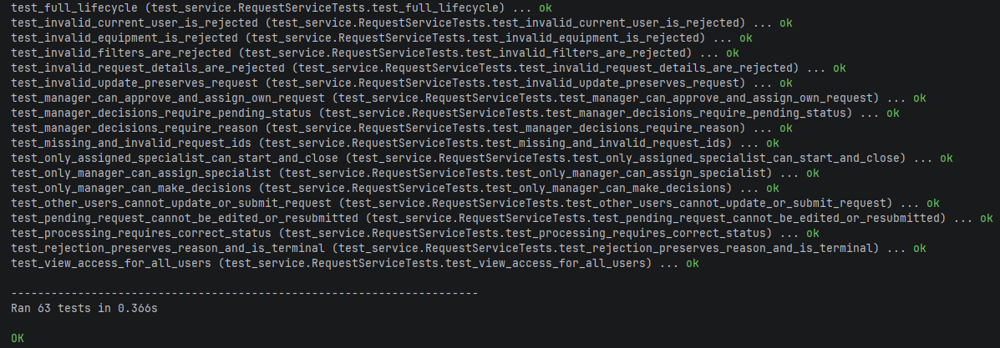

# Проектирование информационной системы учёта и обработки заявок на приобретение оборудования

## Введение

Проектирование программных систем является важным этапом разработки программного обеспечения, в ходе которого определяются состав компонентов, их взаимодействие и требования к будущему решению. Предварительное моделирование позволяет выявить неоднозначности в процессах и согласовать представление о системе до реализации программного кода.

В организациях потребность подразделений в оборудовании сопровождается подготовкой заявок, их согласованием и передачей ответственным специалистам. При отсутствии единого порядка учёта затрудняется определение текущего состояния заявки, ответственного исполнителя и результата её обработки. Для решения этих задач может применяться информационная система централизованного учёта заявок.

**Цель проекта** — спроектировать информационную систему учёта и обработки заявок на приобретение оборудования, разработать программный прототип и проверить его соответствие установленным требованиям.

**Объект исследования** — процесс формирования, согласования и исполнения заявок на приобретение оборудования для подразделений организации.

**Предмет исследования** — методы анализа предметной области, моделирования процессов, проектирования архитектуры и программной реализации средств учёта заявок.

Для достижения цели необходимо исследовать предметную область, определить границы автоматизации и участников, сформулировать требования, построить UML-модели, обосновать архитектуру, реализовать и протестировать прототип, а также оценить возможность его адаптации к изменению требований.

В качестве предметной области выбран **адаптированный вариант № 3** лабораторного практикума «Проектирование информационных систем», посвящённый учёту движения основных средств в отделе материально-технического снабжения (МТС). В отличие от исходного варианта, рассматриваемая система ограничена регистрацией, согласованием и учётом исполнения заявок **на приобретение** оборудования.

Для моделирования процессов и структуры системы использован язык UML и инструмент PlantUML. Прототип реализован на языке Python с разделением пользовательского интерфейса, бизнес-логики и доступа к данным.

## 1. Анализ предметной области и моделирование процессов

### 1.1. Описание предметной области и постановка задачи

В рассматриваемой организации имеются подразделения, которым для выполнения производственных или административных задач требуется оборудование. При возникновении потребности сотрудник подразделения (заявитель) оформляет заявку, указывая необходимое оборудование, количество и обоснование приобретения.

Руководитель отдела МТС рассматривает заявку и выбирает одно из решений — согласовать, отклонить или возвратить на уточнение. Согласованная заявка назначается специалисту МТС. Специалист выполняет необходимые организационные действия вне информационной системы и фиксирует результат обработки. Заявитель может отслеживать состояние своей заявки и уточнять её по запросу руководителя.

Основные объекты предметной области — заявка, оборудование (включая категорию оборудования), пользователь, подразделение, назначенный исполнитель и состояние заявки. Сведения о заявке должны сохраняться и оставаться доступными для просмотра, поиска и контроля её исполнения.

### 1.2. Назначение системы и границы автоматизации

**Назначение системы** — обеспечить единый порядок регистрации и контроля исполнения заявок на приобретение оборудования для подразделений организации.

В границы автоматизации входят:

1. Создание и регистрация заявки с необходимыми реквизитами.
2. Проверка корректности и полноты введённых данных.
3. Передача заявки на согласование руководителю МТС.
4. Согласование, отклонение или возврат заявки на уточнение.
5. Повторное направление исправленной заявки на согласование.
6. Назначение ответственного специалиста МТС.
7. Учёт состояния заявки и результата её обработки.
8. Просмотр, поиск и фильтрация зарегистрированных заявок.

За пределами автоматизации остаются выбор поставщика, заключение договора, закупка и оплата оборудования, ведение бухгалтерского и складского учёта, а также интеграции с внешними системами. Выполнение таких действий отмечается в системе ответственным специалистом вручную, без автоматизации самих внешних операций.

Система реализована в виде учебного прототипа, предназначенного для проверки правил обработки заявок в установленных границах автоматизации.

### 1.3. Участники системы и их обязанности

В информационной системе предусмотрены три роли пользователей — заявитель (сотрудник подразделения), руководитель МТС и специалист МТС. Роль определяет доступные пользователю операции и область просмотра зарегистрированных заявок. В таблице 1.1 представлены участники системы, их обязанности и область доступа к сведениям о заявках.

**Таблица 1.1 — Участники системы и их обязанности**

| Участник | Обязанности | Область просмотра заявок |
| --- | --- | --- |
| **Заявитель (сотрудник подразделения)** | Создаёт собственные заявки, указывает сведения о потребности, направляет заявки на согласование, при необходимости уточняет их и отслеживает ход обработки. | Заявки своего подразделения. |
| **Руководитель МТС** | Создаёт и направляет собственные заявки на согласование, рассматривает поступившие заявки, согласовывает, отклоняет или возвращает их на уточнение, назначает ответственных специалистов и контролирует ход обработки. | Заявки всех подразделений. |
| **Специалист МТС** | Создаёт и направляет собственные заявки на согласование, обрабатывает назначенные ему заявки, организует приобретение оборудования вне системы и фиксирует результат выполнения. | Заявки всех подразделений. |

Как следует из таблицы 1.1, создание заявки доступно каждому пользователю системы независимо от его должностной роли. В рамках конкретной заявки заявителем является сотрудник, создавший её. Изменять количество оборудования и обоснование приобретения, направлять заявку на согласование и повторно отправлять её после уточнения вправе только её заявитель. Редактирование допускается в состояниях «Создана» и «На уточнении».

Обычные сотрудники могут просматривать заявки своего подразделения независимо от того, кем они созданы. Такое ограничение обеспечивает доступ к сведениям о потребностях подразделения и ходе их обработки, не предоставляя доступа к заявкам других подразделений. Право просмотра чужой заявки не предоставляет права изменять её реквизиты или направлять её на согласование.

Руководитель и специалисты МТС имеют доступ к заявкам всех подразделений в связи с централизованной организацией процесса приобретения оборудования. Руководитель МТС является единственным уполномоченным лицом по согласованию заявок и вправе принимать решения в том числе по собственным заявкам. Все заявки проходят единый жизненный цикл независимо от должностной роли их инициатора. Начинать обработку и закрывать заявку вправе только назначенный специалист МТС.

В учебном прототипе допускается выбор текущего пользователя из демонстрационного справочника без полноценной аутентификации. Разграничение доступа к сведениям и операциям выполняется на уровне бизнес-логики с учётом роли, подразделения пользователя, принадлежности заявки и её текущего состояния. Разработка промышленной системы управления учётными записями и механизмов аутентификации в задачи проекта не входит.

### 1.4. Функциональные требования

Функциональные требования определяют действия, необходимые для регистрации, согласования и обработки заявок. В таблице 1.2 приведены функциональные требования к разрабатываемой информационной системе с уникальными идентификаторами, которые далее используются при моделировании и тестировании.

**Таблица 1.2 — Функциональные требования к информационной системе**

| Код | Требование |
| --- | --- |
| **FR-01** | Система должна позволять каждому пользователю создавать собственную заявку с указанием оборудования, количества и обоснования приобретения. Категория определяется по выбранному оборудованию, а заявитель и подразделение — по текущему пользователю. Обязательные данные должны проверяться, при некорректном вводе система должна сообщать об ошибке и не регистрировать заявку. |
| **FR-02** | При регистрации корректно заполненной заявки система должна присваивать ей уникальный идентификатор, дату создания и начальное состояние **«Создана»**. |
| **FR-03** | Система должна предоставлять список зарегистрированных заявок и подробные сведения о выбранной заявке. Обычным сотрудникам доступны заявки своего подразделения, руководителю и специалистам МТС — заявки всех подразделений. |
| **FR-04** | Система должна обеспечивать поиск и фильтрацию доступных пользователю заявок по состоянию, подразделению и категории оборудования с соблюдением установленных ограничений на просмотр. |
| **FR-05** | Каждый пользователь должен иметь возможность направить собственную созданную заявку на согласование. При выполнении операции состояние заявки изменяется на **«На согласовании»**. Направление чужой заявки на согласование запрещено. |
| **FR-06** | Руководитель МТС должен иметь возможность согласовать или отклонить заявку, находящуюся в состоянии **«На согласовании»**, в том числе собственную. При отклонении указание причины обязательно. |
| **FR-07** | Руководитель МТС должен иметь возможность вернуть заявку, находящуюся в состоянии **«На согласовании»**, на уточнение с указанием причины возврата. |
| **FR-08** | Каждый пользователь должен иметь возможность изменять количество оборудования и обоснование приобретения в собственной заявке, находящейся в состоянии **«Создана»** или **«На уточнении»**, а также повторно направлять заявку после возврата на уточнение на согласование без создания новой заявки. Редактирование чужих заявок и заявок в иных состояниях запрещено. |
| **FR-09** | Руководитель МТС должен иметь возможность назначить ответственного специалиста для согласованной заявки. |
| **FR-10** | Назначенный специалист должен иметь возможность начать обработку заявки и после выполнения внешних организационных действий зафиксировать результат и закрыть заявку. |
| **FR-11** | Система должна разрешать только предусмотренные переходы между состояниями заявки, предотвращая недопустимые изменения. |

Требования FR-01—FR-05 определяют порядок создания, регистрации, просмотра, фильтрации и передачи заявок на согласование, FR-06—FR-10 — порядок рассмотрения, уточнения, назначения исполнителя и завершения обработки, FR-11 — контроль допустимых переходов между состояниями. При выполнении операций должны соблюдаться полномочия пользователей, определённые в подразделе 1.3. Эти требования служат основой для последующих UML-моделей, реализации и тестирования прототипа.

В модели процесса операция **«Зарегистрировать заявку»** включает присвоение идентификатора и даты создания по требованию FR-02. Эти технические реквизиты не показаны отдельными действиями UML, чтобы не перегружать диаграмму.

### 1.5. Нефункциональные требования

Помимо предусмотренных функций система должна удовлетворять требованиям к удобству использования, надёжности и качеству программной реализации. В таблице 1.3 приведены нефункциональные требования и способы их последующей проверки.

**Таблица 1.3 — Нефункциональные требования к информационной системе**

| Код | Атрибут качества | Требование и способ последующей проверки |
| --- | --- | --- |
| **NFR-01** | Удобство использования | Пользователь должен выполнять основные операции с заявками через графические формы, при некорректном вводе должны выводиться понятные сообщения об ошибках. Проверяется ручными тестовыми сценариями. |
| **NFR-02** | Надёжность хранения | При использовании постоянного хранилища данные заявок и результаты изменения их состояний должны сохраняться после штатного закрытия и повторного запуска программы. Проверяется повторным запуском прототипа. |
| **NFR-03** | Производительность | Для тестового набора до 1000 заявок отображение и фильтрация списка должны выполняться не более чем за 2 секунды на компьютере, используемом при испытании. Проверяется измерением времени выполнения. |
| **NFR-04** | Сопровождаемость | Интерфейс, бизнес-логика и доступ к данным должны быть разделены так, чтобы изменение способа хранения не требовало изменения правил обработки заявок. Проверяется анализом зависимостей компонентов. |
| **NFR-05** | Проверяемость | Основные операции с заявками и правила изменения состояний должны допускать автоматизированную проверку без запуска графического интерфейса. Проверяется тестами бизнес-логики. |

Сформулированные требования служат критериями оценки прототипа. Результаты испытаний приведены в разделе 4, оценка сопровождаемости — в разделе 5.

### 1.6. Сценарии обработки заявок

Для описания поведения информационной системы рассмотрены основной сценарий обработки заявки, два альтернативных сценария — отклонение и возврат на уточнение — и ситуация некорректного заполнения данных при создании заявки. В таблице 1.4 приведены условия выполнения этих сценариев и ожидаемые результаты.

**Таблица 1.4 — Сценарии обработки заявок на приобретение оборудования**

| Сценарий | Условия выполнения | Результат |
| --- | --- | --- |
| Основной — согласование и выполнение | Заявитель сформировал корректную заявку и направил её на согласование, руководитель принимает положительное решение. | Заявка переведена в состояние «Закрыта». |
| А1 — отклонение | Руководитель отклоняет заявку и указывает причину. | Заявка переведена в конечное состояние «Отклонена». |
| А2 — возврат на уточнение | Руководитель запрашивает уточнение сведений. | Заявитель исправляет исходную заявку и повторно направляет её на согласование. |
| Ошибка заполнения | Обязательные реквизиты отсутствуют или содержат некорректные значения. | Система отображает ошибку, заявка не регистрируется до исправления данных. |

Основной сценарий охватывает полный цикл обработки заявки — от её создания до закрытия. Предполагается, что заявитель и его подразделение определены, а сведения о требуемом оборудовании доступны. Последовательность действий включает следующие этапы:

1. Заявитель заполняет заявку, указывая оборудование, количество и обоснование приобретения. Категория определяется по выбранному оборудованию, а заявитель и подразделение — по текущему пользователю системы.
2. Система проверяет обязательные данные. Если они корректны, заявка регистрируется с присвоением идентификатора, даты создания и состояния **«Создана»**.
3. Заявитель отправляет заявку на согласование. Система устанавливает состояние **«На согласовании»**.
4. Руководитель МТС рассматривает и согласовывает заявку. Система устанавливает состояние **«Согласована»**.
5. Руководитель назначает специалиста МТС. Система устанавливает состояние **«Назначена»**.
6. Специалист приступает к обработке. Система устанавливает состояние **«В работе»**.
7. Специалист организует приобретение оборудования **вне системы** и фиксирует результат обработки в системе.
8. Система устанавливает состояние **«Закрыта»**.

Таким образом, при успешном выполнении основного сценария заявка согласована, закреплена за ответственным специалистом и закрыта после фиксации результата её обработки.

При рассмотрении заявки руководителем на четвёртом этапе возможен **альтернативный сценарий А1 — отклонение**. Руководитель указывает причину отклонения, после чего система сохраняет её и устанавливает состояние **«Отклонена»**. Обработка заявки завершается без назначения специалиста и выполнения закупочных действий. Отклонённая заявка не направляется на повторное согласование, при возникновении новой потребности заявитель создаёт новую заявку.

Другой вариант решения руководителя — **альтернативный сценарий А2 — возврат на уточнение**. В этом случае руководитель указывает причину возврата, а система переводит заявку в состояние **«На уточнении»**. Заявитель изменяет данные существующей заявки и повторно отправляет её на согласование. Система устанавливает состояние **«На согласовании»**, после чего руководитель рассматривает исправленную заявку. Повторное рассмотрение может завершиться согласованием, отклонением либо очередным возвратом на уточнение. Новая заявка при этом не создаётся.

Отдельно предусмотрена **обработка некорректных данных при создании заявки**. Если обязательные сведения об оборудовании, его количестве или обосновании отсутствуют либо количество указано некорректно, система сообщает об ошибке. Заявитель исправляет введённые данные, после чего проверка выполняется повторно. До успешного прохождения проверки заявка **не регистрируется** и идентификатор ей не присваивается.

Для последующей разработки диаграммы состояний UML State Machine необходимо определить разрешённые изменения состояния заявки. В таблице 1.5 приведены допустимые переходы и события, которыми они инициируются.

**Таблица 1.5 — Допустимые переходы между состояниями заявки**

| Исходное состояние | Новое состояние | Основание перехода |
| --- | --- | --- |
| Создана | На согласовании | Заявитель отправил заявку. |
| На согласовании | Согласована | Руководитель согласовал заявку. |
| На согласовании | Отклонена | Руководитель отклонил заявку с указанием причины. |
| На согласовании | На уточнении | Руководитель вернул заявку на уточнение. |
| На уточнении | На согласовании | Заявитель исправил и повторно отправил заявку. |
| Согласована | Назначена | Руководитель назначил специалиста МТС. |
| Назначена | В работе | Специалист начал обработку. |
| В работе | Закрыта | Специалист зафиксировал результат выполнения. |

Состояния **«Отклонена»** и **«Закрыта»** являются конечными. Изменения состояния, не предусмотренные таблицей 1.5, должны отклоняться системой. Эти правила формализованы диаграммой состояний в подразделе 2.4.

### 1.7. Моделирование процесса обработки заявки

В качестве модели ключевого процесса выбрана **диаграмма деятельности UML (Activity)** «Обработка заявки на приобретение оборудования», подготовленная в PlantUML. На рисунке 1.1 представлена последовательность действий участников процесса, включая основные решения и альтернативные варианты обработки заявки.


*Рисунок 1.1 — Диаграмма деятельности процесса обработки заявки на приобретение оборудования.*

[Редактируемый исходник диаграммы PlantUML](../diagrams/activity/activity.puml).

На диаграмме представлены четыре дорожки ответственности — **«Заявитель»**, **«Система»**, **«Руководитель МТС»** и **«Специалист МТС»**. Первые, третья и четвёртая обозначают действия участников процесса, а дорожка «Система» — автоматические операции проверки данных, регистрации заявки и изменения её состояния.

Дорожки отражают функции участников в рамках конкретной заявки, а не обязательно разных физических лиц — один пользователь может выступать в качестве заявителя и руководителя МТС в пределах установленных полномочий.

Ветвления и циклы на диаграмме соответствуют альтернативным сценариям подраздела 1.6. При возврате на уточнение повторно рассматривается **та же заявка**, а отклонение завершает процесс. Приобретение оборудования обозначено как внешнее действие специалиста МТС.

### 1.8. Выводы по результатам анализа

Анализ предметной области позволил определить границы автоматизации и отделить процесс учёта заявок от внешних закупочных операций. Установленные полномочия пользователей и допустимые состояния заявок образуют основу функциональной модели системы.

Сформулированные требования FR-01—FR-11 и NFR-01—NFR-05, сценарии и диаграмма деятельности служат исходными данными для моделирования структуры и поведения системы в разделе 2.

## 2. UML-моделирование информационной системы

Для формализации требований и сценариев раздела 1 используются UML-модели, отражающие функции системы, её статическую структуру и динамику взаимодействия участников и программных компонентов.

### 2.1. Диаграмма вариантов использования

Диаграмма вариантов использования (Use Case) определяет функции, доступные пользователям системы, и показывает взаимодействие внешних участников с проектируемым программным решением. На рисунке 2.1 представлена диаграмма вариантов использования информационной системы учёта заявок на приобретение оборудования.



*Рисунок 2.1 — Диаграмма вариантов использования системы учёта заявок на приобретение оборудования*

На диаграмме представлены три основные роли — заявитель, руководитель МТС и специалист МТС. Для общих действий введён обобщённый актор «Пользователь системы», от которого наследуются указанные роли. Обобщённый актор не обозначает отдельную категорию пользователей, а позволяет определить общий набор функций без дублирования связей с вариантами использования.

Связи обобщённого актора с вариантами использования отражают общие операции — просмотр, фильтрацию, создание, редактирование и отправку собственных заявок. Область просмотра и условия выполнения действий определены в подразделе 1.3 и требованиях FR-03, FR-05 и FR-08.

Первичная и повторная отправка на согласование представлены одним вариантом использования, поскольку выполняются посредством одной операции.

Специализированные варианты использования относятся к рассмотрению заявок и назначению исполнителей руководителем МТС, а также к обработке и закрытию назначенных заявок специалистом. Диаграмма показывает распределение функций, ограничения на их выполнение, включая право руководителя согласовывать собственные заявки, определены в подразделе 1.3.

Обязательная проверка данных представлена отношениями `<<include>>` при создании и редактировании заявки. Проверка введённых сведений рассматривается как неотъемлемая часть этих операций и не требует самостоятельного действия пользователя.

Таким образом, диаграмма отражает функциональные требования FR-01—FR-11, определённые в таблице 1.2, с учётом разграничения полномочий пользователей. Допустимая последовательность выполнения операций определяется моделью состояний заявки, рассмотренной в подразделе 2.4.

### 2.2. Диаграмма классов

Для описания статической структуры системы разработана диаграмма классов (Class), представленная на рисунке 2.2. Она содержит основные классы предметной области, сервис обработки заявок, абстрактный класс репозитория и его реализацию для SQLite. Классы сгруппированы в три пакета — «Предметная область», «Бизнес-логика» и «Доступ к данным».



*Рисунок 2.2 — Диаграмма классов информационной системы учёта заявок на приобретение оборудования*

Основные классы диаграммы и их назначение приведены в таблице 2.1.

**Таблица 2.1 — Основные классы информационной системы**

| Элемент | Назначение |
| --- | --- |
| `Department` | Хранение сведений о подразделении организации. |
| `User` | Представление пользователя, его роли и принадлежности к подразделению. |
| `EquipmentCategory` | Описание категории оборудования. |
| `Equipment` | Хранение сведений об оборудовании и его принадлежности к категории. |
| `EquipmentRequest` | Хранение реквизитов заявки, её состояния, назначенного специалиста, причины решения руководителя и результата обработки, контроль допустимых переходов состояния. |
| `RequestService` | Координация бизнес-операций, проверка полномочий пользователя, получение и сохранение заявок через репозиторий. |
| `RequestRepository` | Определение абстрактного контракта добавления, получения, перечисления и сохранения заявок независимо от конкретного хранилища. |
| `SQLiteRequestRepository` | Реализация операций репозитория с использованием локальной базы данных SQLite. |

Класс `EquipmentRequest` является центральной сущностью модели. С заявкой связаны заявитель, необязательный назначенный исполнитель, подразделение и оборудование. Ассоциации снабжены кратностями, позволяющими определить количество связанных объектов. Каждая заявка относится к одному заявителю, одному подразделению и одной позиции оборудования. Пользователь может создать несколько заявок, а исполнитель может отсутствовать до назначения специалиста.

В программной модели указанные отношения представлены идентификаторами связанных объектов. Атрибут `User.department_id` определяет принадлежность пользователя к подразделению, а `Equipment.category_id` — принадлежность оборудования к категории. В классе `EquipmentRequest` предусмотрены атрибуты `applicant_id`, `department_id`, `equipment_id` и `assigned_specialist_id`. Ассоциации на диаграмме отражают логические отношения предметной области, а идентификаторы — способ их представления в программном коде.

Перечисление `UserRole` определяет допустимые роли пользователей (`APPLICANT`, `MANAGER`, `SPECIALIST`), а `RequestStatus` — восемь состояний заявки. Зависимости от перечислений согласованы с типами атрибутов `User.role` и `EquipmentRequest.status`. Атрибуты `assigned_specialist_id`, `decision_reason` и `completion_result` допускают отсутствие значения (`None`), поскольку соответствующие сведения появляются на разных этапах обработки заявки.

Метод `EquipmentRequest.update_details()` изменяет количество оборудования и обоснование приобретения, `assign_specialist()` устанавливает идентификатор исполнителя, `can_transition_to()` проверяет допустимость перехода между состояниями, а `change_status()` выполняет изменение состояния с проверкой необходимых условий.

Класс `RequestService` предоставляет публичные операции создания, редактирования, согласования, назначения, обработки, получения и фильтрации заявок. Через конструктор сервис получает репозиторий, текущего пользователя и справочные данные пользователей и оборудования. Перед выполнением операций сервис проверяет полномочия текущего пользователя, а при просмотре и фильтрации учитывает доступную ему область заявок. Необязательные параметры метода `filter_requests()` позволяют применять отдельные критерии или их сочетания.

`RequestRepository` представлен абстрактным классом, определяющим операции `add()`, `get_by_id()`, `list_all()` и `save()`. Класс `SQLiteRequestRepository` наследуется от него и реализует эти операции для конкретного хранилища. Сервис зависит от абстрактного контракта, а экземпляр репозитория передаётся ему извне через конструктор. Такая организация отделяет правила обработки заявок от способа их хранения.

Диаграмма уточнена по результатам разработки прототипа — отражены фактически используемые идентификаторы, типы данных, публичные операции и реализация репозитория. Вспомогательные методы и классы графического интерфейса не представлены, поскольку диаграмма предназначена для описания основных классов предметной области, бизнес-логики и доступа к данным. Программная реализация этих компонентов рассматривается в разделе 3.

### 2.3. Диаграмма деятельности

Динамика обработки заявки ранее представлена диаграммой деятельности (Activity) на рисунке 1.1. Она используется также в настоящем этапе, поскольку построена на основе тех же участников и требований.

Диаграмма охватывает регистрацию заявки, проверку введённых данных, передачу на согласование, рассмотрение руководителем, назначение специалиста и завершение обработки. Предусмотрены альтернативные пути отклонения и возврата на уточнение. Дорожка «Система» отделяет автоматические действия приложения от действий пользователей.

Дорожка «Заявитель» обозначает инициатора конкретной заявки, а не исключительно пользователя с ролью `APPLICANT`. В этой части процесса могут участвовать также руководитель и специалисты МТС при создании собственных заявок. Полномочия руководителя и специалиста при рассмотрении и исполнении заявок определяются их должностными ролями.

Повторное построение Activity-диаграммы не требуется. Сценарии из подраздела 1.6 и модель на рисунке 1.1 используются как общая основа для проверки остальных UML-диаграмм.

### 2.4. Диаграмма состояний заявки

Для формализации жизненного цикла объекта `EquipmentRequest` построена диаграмма состояний (State Machine), представленная на рисунке 2.3. Она основана на допустимых переходах, указанных в таблице 1.5.


*Рисунок 2.3 — Диаграмма состояний заявки на приобретение оборудования*

После регистрации заявка находится в состоянии «Создана», затем может быть направлена на согласование. Руководитель согласовывает её, отклоняет с указанием причины либо возвращает на уточнение. В последнем случае заявитель исправляет сведения и повторно отправляет ту же заявку на согласование.

После согласования и назначения специалиста заявка последовательно переходит в состояния «Назначена» и «В работе». Фиксация результата выполнения переводит её в состояние «Закрыта». Состояния «Отклонена» и «Закрыта» завершают соответствующие ветви процесса.

Диаграмма определяет разрешённые изменения состояния. В прототипе контроль допустимости переходов осуществляется методами `can_transition_to()` и `change_status()` класса `EquipmentRequest`, а проверка полномочий пользователя — в `RequestService`. Жизненный цикл един для всех заявок независимо от должностной роли их инициатора. Результаты проверки указанных правил будут представлены в разделе 4.

### 2.5. Диаграмма последовательности

Для детализации взаимодействия компонентов при создании и назначении заявки разработана диаграмма последовательности (Sequence), представленная на рисунке 2.4.


*Рисунок 2.4 — Диаграмма последовательности создания и назначения заявки на приобретение оборудования*

На диаграмме участвуют заявитель, руководитель МТС, пользовательский интерфейс, `RequestService`, объект `EquipmentRequest` и `RequestRepository`. Основной сценарий разделён на четыре последовательных этапа — создание заявки, направление на согласование, согласование и назначение специалиста. Под заявителем понимается инициатор заявки независимо от его должностной роли.

При создании заявки интерфейс вызывает `RequestService.create_request()`. Сервис проверяет принадлежность идентификатора заявителя текущему пользователю и наличие оборудования в справочнике, создаёт объект `EquipmentRequest` в состоянии `CREATED` и передаёт его в репозиторий для сохранения. Проверка количества и обоснования выполняется в предметной модели при создании объекта. На диаграмме проверки обобщены без детализации внутренних вызовов.

При передаче заявки на согласование и положительном решении руководителя сервис получает заявку из репозитория, проверяет полномочия пользователя, вызывает метод `change_status()` с соответствующим значением `RequestStatus` и сохраняет изменения.

На этапе назначения руководитель инициирует `RequestService.assign_specialist()`. Сервис проверяет роль текущего пользователя и выбранного исполнителя, получает заявку, вызывает `EquipmentRequest.assign_specialist(specialist_id)`, устанавливает состояние `ASSIGNED` и сохраняет изменённый объект. Эта последовательность соответствует атрибутам и операциям UML Class.

Условные ответы `OK` на диаграмме обозначают успешное завершение операции, а не конкретные возвращаемые значения методов Python. Диаграмма показывает основной успешный путь. Альтернативные ситуации отклонения и возврата на уточнение уже определены диаграммами Activity и State Machine, поэтому здесь повторно не рассматриваются.

### 2.6. Проверка согласованности моделей и выводы

Соответствие UML-моделей требованиям раздела 1 проверено с учётом фактической структуры прототипа. Диаграммы Use Case и Class уточнены в соответствии с окончательной моделью доступа и программными интерфейсами. Основные связи между моделями приведены в таблице 2.2.

**Таблица 2.2 — Согласованность UML-моделей**

| Модель | Что отражает | Связь с остальными моделями |
| --- | --- | --- |
| Use Case | Общие и специализированные функции пользователей | Основана на ролях, области доступа и требованиях FR-01—FR-11. |
| Class | Структура данных, операции и связи классов | Определяет классы и методы, используемые в Sequence, и соответствует основным компонентам реализованного прототипа. |
| Activity | Общий порядок обработки заявки и альтернативные сценарии | Согласована со сценариями подраздела 1.6 и состояниями заявки. |
| State Machine | Допустимые состояния и переходы объекта `EquipmentRequest` | Соответствует перечислению `RequestStatus`, таблице 1.5 и правилам предметной модели. |
| Sequence | Взаимодействие компонентов при создании и назначении заявки | Использует публичные операции `RequestService`, `EquipmentRequest` и `RequestRepository`, определённые в Class. |

По результатам сопоставления установлено, что основные участники, операции и состояния заявок согласованы между моделями. Например, назначение специалиста представлено действием руководителя МТС в Use Case, бизнес-операцией `RequestService.assign_specialist()` и вызовом метода `EquipmentRequest.assign_specialist()` на диаграмме последовательности. Состояние `ASSIGNED` соответствует следующему этапу жизненного цикла заявки.

Модели функций, классов, состояний и взаимодействий согласованы с архитектурными моделями и программным прототипом, представленными в разделе 3. Проверка реализации приведена в разделе 4, оценка архитектуры — в разделе 5.

## 3. Проектирование архитектуры и разработка прототипа

Архитектура прототипа определяет распределение ответственности между программными компонентами и способ их взаимодействия. В основу реализации положены требования раздела 1 и UML-модели раздела 2.

Прототип реализован на языке Python с графическим интерфейсом Tkinter и локальным хранилищем SQLite.

### 3.1. Выбор архитектурного стиля

Для учебной системы выбрана **слоистая архитектура** с разделением пользовательского интерфейса, бизнес-логики и доступа к данным. Приложение реализовано как локальная программа, выполняемая на одном компьютере, выделенный сервер приложений и сетевой обмен между компонентами не используются.

Выбор слоистой архитектуры обусловлен характером решаемой задачи. Пользовательский интерфейс отвечает за ввод и отображение сведений, бизнес-логика — за выполнение операций и соблюдение правил обработки заявок, слой доступа к данным — за сохранение объектов независимо от их представления на экране. Такое разделение упрощает сопровождение и позволяет проверять основные правила без запуска графического интерфейса.

Внутри слоя бизнес-логики отдельно выделена предметная модель. Класс `EquipmentRequest` содержит данные заявки и правила изменения её состояния, тогда как `RequestService` проверяет полномочия пользователя и координирует выполнение операций. Для обращения к хранилищу сервис использует абстрактный интерфейс `RequestRepository`, а не конкретные SQL-запросы. Это обеспечивает независимость бизнес-логики от выбранного способа хранения в пределах установленного интерфейса.

Оценка возможностей развития и ограничений выбранной архитектуры приведена в разделе 5.

### 3.2. Компонентная структура и размещение системы

Для представления основных программных частей и зависимостей между ними разработана диаграмма компонентов (Component), приведённая на рисунке 3.1.



*Рисунок 3.1 — Диаграмма компонентов информационной системы учёта заявок на приобретение оборудования*

Диаграмма отражает взаимодействие `Tkinter UI`, `RequestService`, моделей предметной области и компонентов хранения. Интерфейс `RequestRepository` задаёт общий контракт доступа к заявкам, компонент `SQLiteRequestRepository` реализует этот контракт и взаимодействует с локальной базой данных посредством модуля `sqlite3`. Таким образом, пользовательские действия проходят через сервисный слой, а программный код предметной области не содержит SQL-запросов.

Ответственность компонентов и их соответствие модулям Python представлены в таблице 3.1.

**Таблица 3.1 — Назначение компонентов программного прототипа**

| Логическая часть | Основные модули | Ответственность |
| --- | --- | --- |
| Пользовательский интерфейс | [`ui/app.py`](../../src/equipment_requests/ui/app.py) | Отображение заявок, формы ввода, фильтры и вызов операций сервиса. |
| Предметная область | [`domain/enums.py`](../../src/equipment_requests/domain/enums.py), [`domain/models.py`](../../src/equipment_requests/domain/models.py) | Пользователи, подразделения, оборудование, заявка и допустимые переходы состояний. |
| Бизнес-логика | [`services/request_service.py`](../../src/equipment_requests/services/request_service.py) | Проверка полномочий, регистрация, согласование, назначение, закрытие и поиск заявок. |
| Доступ к данным | [`repositories/base.py`](../../src/equipment_requests/repositories/base.py), [`repositories/sqlite_repository.py`](../../src/equipment_requests/repositories/sqlite_repository.py) | Контракт хранения и реализация операций с SQLite. |
| Сборка и запуск | [`bootstrap.py`](../../src/equipment_requests/bootstrap.py), [`data/reference_data.py`](../../src/equipment_requests/data/reference_data.py), [`__main__.py`](../../src/equipment_requests/__main__.py) | Создание компонентов, демонстрационные справочники и точка входа. |

Представленное разделение определяет структуру каталога `src/equipment_requests/`. Ссылки в таблице 3.1 ведут непосредственно к исходным файлам соответствующих компонентов в репозитории.

Физическое размещение приложения представлено диаграммой развёртывания (Deployment) на рисунке 3.2.


*Рисунок 3.2 — Диаграмма развёртывания информационной системы учёта заявок на приобретение оборудования*

В рассматриваемой конфигурации пользователь работает на компьютере под управлением Windows. Приложение `equipment_requests` выполняется в среде Python 3.14 и включает графический интерфейс, сервис обработки заявок, модели предметной области и SQLite-репозиторий. Данные заявок сохраняются в локальном файле `requests.db`. Выделенный сервер базы данных не требуется.

### 3.3. Пользовательский интерфейс

Пользовательский интерфейс реализован средствами стандартной библиотеки Tkinter. Основная форма содержит выбор демонстрационного пользователя, фильтры по состоянию, подразделению и категории оборудования, таблицу зарегистрированных заявок, сведения о выбранной заявке и кнопки выполнения доступных операций. Общий вид приложения представлен на рисунке 3.3.


*Рисунок 3.3 — Главное окно прототипа со списком заявок и средствами фильтрации*

Выбор пользователя выполняется из демонстрационного справочника без аутентификации. Интерфейс отображает доступные заявки в соответствии с правилами подраздела 1.3, а проверка полномочий выполняется в `RequestService`.

Создание заявки выполняется в отдельной форме, где пользователь выбирает оборудование, указывает количество и обоснование приобретения. Пример формы приведён на рисунке 3.4.


*Рисунок 3.4 — Форма создания заявки на приобретение оборудования*

После успешного ввода данных интерфейс вызывает `RequestService.create_request()`. Заявке присваивается идентификатор, дата создания и начальное состояние `CREATED`. Отправка на согласование выполняется отдельным действием. Ошибки заполнения обязательных полей отображаются пользователю в диалоговом окне.

Для руководителя МТС предусмотрены согласование, отклонение, возврат на уточнение и назначение специалиста. После согласования заявки руководитель выбирает исполнителя из демонстрационного справочника. Соответствующий этап работы представлен на рисунке 3.5.


*Рисунок 3.5 — Назначение специалиста МТС для согласованной заявки*

Назначенный специалист может начать обработку и закрыть заявку после внесения результата. Для ввода причин отклонения, возврата на уточнение и результата обработки используются многострочные текстовые поля. Пример закрытой заявки с сохранённым результатом показан на рисунке 3.6.


*Рисунок 3.6 — Закрытая заявка с назначенным исполнителем и результатом обработки*

Доступность кнопок зависит от роли пользователя и состояния выбранной заявки. Эти ограничения отображения не заменяют проверок в сервисном слое — прямой вызов его методов также проходит контроль полномочий и допустимости операции. Реализация интерфейса сосредоточена в модуле [`ui/app.py`](../../src/equipment_requests/ui/app.py).

### 3.4. Предметная область и бизнес-логика

Предметная область реализована в модулях [`domain/enums.py`](../../src/equipment_requests/domain/enums.py) и [`domain/models.py`](../../src/equipment_requests/domain/models.py). Для описания данных используются классы `dataclass`, а роли пользователей и состояния заявок представлены перечислениями `UserRole` и `RequestStatus`. Центральным объектом является `EquipmentRequest`, содержащий идентификаторы заявителя, подразделения и оборудования, количество, обоснование, дату создания, состояние, назначенного специалиста и сведения о результате обработки.

Методы `EquipmentRequest.update_details()`, `assign_specialist()`, `can_transition_to()` и `change_status()` реализуют правила изменения данных и переходы между состояниями, заданные диаграммой State Machine (рисунок 2.3). Например, назначение специалиста допускается только после согласования заявки, а переход в состояние `CLOSED` требует указания результата выполнения. Недопустимые переходы приводят к ошибке и не сохраняются как завершённая операция.

Класс [`RequestService`](../../src/equipment_requests/services/request_service.py) предоставляет операции, необходимые для выполнения пользовательских сценариев. Основные публичные методы приведены в таблице 3.2.

**Таблица 3.2 — Основные публичные операции сервиса обработки заявок**

| Операция | Назначение |
| --- | --- |
| `create_request()`, `update_request()` | Регистрация и изменение собственной заявки. |
| `submit_request()` | Направление созданной или уточнённой заявки на согласование. |
| `approve_request()`, `reject_request()`, `request_clarification()` | Принятие решения руководителем МТС. |
| `assign_specialist()` | Назначение исполнителя по согласованной заявке. |
| `start_processing()`, `close_request()` | Начало обработки и фиксация результата специалистом. |
| `get_request()`, `filter_requests()` | Получение сведений и отбор заявок с учётом прав просмотра. |

При выполнении операций `RequestService` использует контекст текущего пользователя. Методы `_require_role()` и `_require_owner()` проверяют роль и принадлежность заявки, `_can_view()` определяет допустимую область просмотра. Проверка назначения исполнителя выполняется при начале обработки и закрытии заявки. Правила разграничения полномочий из подраздела 1.3 применяются независимо от доступности действий в графическом интерфейсе.

Для выполнения бизнес-операции сервис получает объект через `RequestRepository`, применяет правила предметной области и сохраняет изменённый объект посредством репозитория.

### 3.5. Доступ к данным

Для постоянного хранения заявок используется SQLite, работа с которой выполняется стандартным модулем Python `sqlite3`. В модуле [`repositories/base.py`](../../src/equipment_requests/repositories/base.py) определён абстрактный класс `RequestRepository` с методами `add()`, `get_by_id()`, `list_all()` и `save()`. Он представляет контракт, от которого зависит сервис обработки заявок.

Модуль [`repositories/sqlite_repository.py`](../../src/equipment_requests/repositories/sqlite_repository.py) содержит класс `SQLiteRequestRepository`, реализующий указанные операции. При первом подключении создаётся таблица `requests`, если она ещё отсутствует. Для каждой заявки сохраняются основные реквизиты, состояние, назначенный исполнитель, причина решения руководителя и результат выполнения. При добавлении записи база присваивает уникальный идентификатор, при чтении данные преобразуются обратно в объект `EquipmentRequest`.

Для выполнения операций записи применяются параметризованные SQL-запросы. После завершения транзакции сведения остаются в файле `requests.db` и доступны при следующем запуске приложения.

Сведения о пользователях, подразделениях, категориях и оборудовании представлены фиксированными демонстрационными наборами в модуле [`data/reference_data.py`](../../src/equipment_requests/data/reference_data.py). Их администрирование через интерфейс не предусмотрено.

### 3.6. Сборка компонентов и запуск прототипа

Сборка компонентов вынесена в модуль [`bootstrap.py`](../../src/equipment_requests/bootstrap.py). Функция `create_repository()` создаёт экземпляр `SQLiteRequestRepository`, а `create_service()` формирует `RequestService` для выбранного демонстрационного пользователя, передавая ему репозиторий и справочные данные. При переключении пользователей используется общее хранилище заявок.

Точкой входа является модуль [`__main__.py`](../../src/equipment_requests/__main__.py), который создаёт приложение `EquipmentRequestsApp` и запускает цикл обработки событий Tkinter. Для запуска из корня проекта используются команды:

```powershell
uv sync
uv run python -m equipment_requests
```

Для разработки используется Python 3.14 и управление окружением через `uv`. Сторонние библиотеки для графического интерфейса, SQLite и базового тестирования не требуются, поскольку Tkinter, `sqlite3` и `unittest` входят в стандартную библиотеку Python. Конфигурация проекта определена файлом `pyproject.toml`.

Исходные UML-модели подготовлены в PlantUML. Генерация программного кода из диаграмм не применялась. Классы и модули реализованы вручную в соответствии с согласованной структурой, интерфейсами и сценариями. Такой способ позволил отдельно реализовать проверки состояний, разграничение полномочий и преобразование данных SQLite.

### 3.7. Выводы по результатам проектирования и реализации

Разделение пользовательского интерфейса, бизнес-логики и хранения данных реализовано в виде локального приложения. Соответствие программных компонентов архитектурным моделям определяется их назначением и зависимостями, описанными в подразделах 3.2–3.6.

Работоспособность реализованных операций проверена в разделе 4, возможности изменения и развития выбранной архитектуры оценены в разделе 5.

## 4. Тестирование программного прототипа

Для проверки соответствия прототипа требованиям раздела 1 используются сценарии, согласованные с UML-моделями раздела 2 и программной реализацией раздела 3.

### 4.1. Цель и организация тестирования

Тестирование направлено на проверку работоспособности прототипа, корректности обработки данных и соблюдения правил изменения состояний. Поведение интерфейса проверено вручную, предметная модель, доступ к данным и бизнес-логика — автоматизированно. Отдельно измерено время отображения и фильтрации списка заявок.

Испытательная аппаратно-программная конфигурация приведена в таблице 4.1.

**Таблица 4.1 — Конфигурация испытательного компьютера**

| Параметр | Значение |
| --- | --- |
| Процессор | Intel Core i5-13600K |
| Количество физических ядер | 14 |
| Количество логических процессоров | 20 |
| Оперативная память | 63,71 ГиБ по данным операционной системы |
| Операционная система | Windows 11, сборка 26200 |
| Версия Python | 3.14.10 |
| Версия SQLite | 3.53.1 |
| Версия Tcl/Tk | 9.0.4 |
| Средство управления окружением | uv |
| Средство автоматизированного тестирования | unittest |

Автоматизированные проверки размещены в каталоге `tests/`. Для испытаний, требующих постоянного хранилища, создаются отдельные временные файлы базы данных SQLite. Каждый тест получает независимое окружение, которое удаляется после завершения проверки. Рабочая база `requests.db` не используется и не изменяется. Тесты предметной модели не требуют обращения к базе данных, а функциональные автоматизированные проверки не требуют запуска графического интерфейса.

Сценарий измерения производительности запускается отдельно, поскольку для него необходимо графическое окружение, а результаты зависят от аппаратных ресурсов и текущей загрузки компьютера.

### 4.2. Ручное функциональное тестирование

В процессе разработки прототипа выполнена ручная проверка посредством графического интерфейса Tkinter. Исходный рабочий перечень включал 22 сценария, охватывавших создание, редактирование, согласование, возврат на уточнение, отклонение, назначение исполнителя, закрытие, фильтрацию и сохранность данных. После первоначальной проверки уточнены правила доступа и выполнены контрольные проверки изменённого поведения. Результаты основных сценариев, сгруппированных по проверяемым операциям, представлены в таблице 4.2.

**Таблица 4.2 — Основные сценарии функционального тестирования**

| № | Сценарий | Ожидаемый результат | Фактический результат |
| --- | --- | --- | --- |
| 1 | Создать заявку с корректными данными (FR-01, FR-02) | Заявка регистрируется с уникальным идентификатором, датой создания и состоянием «Создана». | Заявка создана и отображается в списке. |
| 2 | Указать некорректное количество или пустое обоснование (FR-01, NFR-01) | Некорректные данные не принимаются, выводится сообщение об ошибке. | Ввод отклонён, некорректная заявка не зарегистрирована. |
| 3 | Изменить собственную созданную заявку (FR-08) | Изменяются количество и обоснование, идентификатор и состояние сохраняются. | Реквизиты изменены без создания новой заявки. |
| 4 | Отправить заявку на согласование (FR-05, FR-11) | Устанавливается состояние «На согласовании», редактирование и повторная отправка недоступны. | Состояние изменено, недопустимые действия заблокированы. |
| 5 | Вернуть заявку на уточнение и повторно направить её на согласование (FR-07, FR-08) | Причина возврата сохраняется, исправленная заявка повторно направляется без изменения идентификатора. | Выполнен цикл уточнения и повторной отправки той же заявки. |
| 6 | Согласовать заявку руководителем МТС (FR-06) | Заявка получает состояние «Согласована». | Состояние изменено, доступно назначение специалиста. |
| 7 | Отклонить заявку с указанием причины (FR-06, FR-11) | Устанавливается конечное состояние «Отклонена», причина сохраняется. | Отклонение выполнено после направления заявки на согласование. |
| 8 | Назначить специалиста МТС (FR-09) | Сохраняется выбранный исполнитель, устанавливается состояние «Назначена». | Исполнитель назначен и отображается в сведениях о заявке. |
| 9 | Начать обработку назначенной заявки (FR-10) | Назначенному специалисту доступен переход в состояние «В работе». | Обработка начата назначенным специалистом. |
| 10 | Закрыть заявку с результатом обработки (FR-10, FR-11) | Результат сохраняется, устанавливается состояние «Закрыта». | Заявка закрыта, результат отображается в карточке. |
| 11 | Применить фильтры списка (FR-03, FR-04) | Отображаются заявки, соответствующие выбранным условиям и доступной области просмотра. | Отбор заявок выполнен, окончательные ограничения просмотра дополнительно проверены автоматизированными тестами. |
| 12 | Перезапустить приложение после сохранения заявок (NFR-02) | Сохранённые сведения, состояния и результаты обработки остаются доступными. | Сохранённые заявки доступны после повторного запуска. |

Таблица 4.2 обобщает результаты ручных сценариев. Первоначальные проверки ограничений ролей относились к более ранней версии модели доступа, окончательные правила подраздела 1.3 проверены в сервисном слое (подраздел 4.5).

По результатам ручной проверки уточнено оформление диалогов ввода причин решений и результата обработки, добавлены многострочные поля. Недоступность отклонения до отправки заявки на согласование признана корректным поведением согласно диаграмме состояний. Изменения полномочий и области просмотра являлись уточнением требований, не затрагивающим жизненный цикл заявки.

Примеры работы графического интерфейса представлены на рисунках 3.3–3.6. Результаты ручных проверок подтверждают возможность выполнения основных пользовательских операций, однако не являются формальной оценкой удобства использования на различных рабочих местах.

### 4.3. Автоматизированное тестирование предметной области

Проверки предметной модели реализованы в модуле [`test_domain.py`](../../tests/test_domain.py). Используются два тестовых класса — `UserTests` и `EquipmentRequestTests`. Первый проверяет определение роли пользователя, второй — создание объекта заявки, валидацию его реквизитов и правила изменения состояния.

В тестах проверяются начальные значения атрибутов, допустимость идентификаторов и количества оборудования, обязательность обоснования, возможность редактирования только в предусмотренных состояниях, назначение специалиста и обязательность причины решения или результата обработки при соответствующих переходах. Отдельные проверки подтверждают, что ошибочное редактирование не изменяет реквизиты заявки.

Для проверки FR-11 используется тест `test_transition_matrix()`. Он охватывает все комбинации восьми исходных и восьми целевых состояний, включая переходы из состояния в него же. Ожидаемые переходы определены независимо от используемого в модели словаря `_ALLOWED_TRANSITIONS` на основании таблицы 1.5 и диаграммы состояний (рисунок 2.3).

Из 64 сочетаний допустимы 8 переходов, остальные 56 запрещены. С помощью `subTest()` проверяются допустимость переходов и изменение либо сохранение исходного состояния объекта. Дополнительно проверены условия переходов, требующие указания исполнителя, причины решения и результата обработки.

Для запуска проверок предметной модели используется команда:

```powershell
uv run python -m unittest discover -s tests -p "test_domain.py" -v
```

### 4.4. Автоматизированное тестирование слоя доступа к данным

Проверки реализованы в модуле [`test_repository.py`](../../tests/test_repository.py) в классе `SQLiteRequestRepositoryTests`. Используется фактическая реализация `SQLiteRequestRepository` с временной файловой базой данных, что позволяет проверить SQL-операции и преобразование данных без изменения рабочей базы приложения.

Проверяются соответствие репозитория абстрактному контракту, создание пустого хранилища, присвоение уникальных идентификаторов, получение заявок, перечисление записей и сохранение изменённых объектов. Негативные сценарии включают повторное добавление уже зарегистрированной заявки, попытку обновления незарегистрированного объекта и обращение к отсутствующей записи.

Для проверки NFR-02 выполняется создание нового экземпляра репозитория с тем же файлом базы данных. После повторного открытия сравниваются сохранённые реквизиты заявки, состояние, назначенный специалист, причины решений и результат обработки. Также проверяется сохранение кириллицы, кавычек и переносов строк.

Отдельно проверяется действие ограничений SQLite при записи некорректного количества оборудования. Тесты намеренно устанавливают недопустимое значение в объекте заявки, минуя проверку предметной модели, и ожидают исключение `sqlite3.IntegrityError`. После неуспешной вставки или обновления проверяется отсутствие некорректной записи и сохранность ранее записанных данных. Эти проверки подтверждают действие конкретных ограничений схемы, но не означают, что все бизнес-правила реализованы на уровне СУБД.

Для запуска используется команда:

```powershell
uv run python -m unittest discover -s tests -p "test_repository.py" -v
```

### 4.5. Автоматизированное тестирование бизнес-логики

Проверки сервисного слоя реализованы в модуле [`test_service.py`](../../tests/test_service.py) в классе `RequestServiceTests`. Тесты выполняются с использованием фактических справочников пользователей и оборудования, сервиса `RequestService` и SQLite-репозитория. По характеру взаимодействия компонентов эти проверки являются интеграционными тестами бизнес-логики и слоя доступа к данным.

Выполняются основной жизненный цикл заявки, альтернативные сценарии отклонения и возврата на уточнение, проверка корректности данных, допустимости операций, роли текущего пользователя, принадлежности заявки и назначения исполнителя. Дополнительно проверяются фильтры по состоянию, подразделению и категории оборудования, включая их совместное применение.

При проверке запрещённых операций вспомогательный метод `assert_operation_rejected()` сравнивает содержимое хранилища до и после операции. Ожидаемое исключение является необходимым, но не единственным условием успешной проверки — ранее сохранённые данные должны оставаться неизменными.

В таблице 4.3 приведены примеры автоматизированных сценариев окончательной версии модели доступа и бизнес-процесса.

**Таблица 4.3 — Проверка бизнес-правил и разграничения полномочий**

| Сценарий | Ожидаемый результат | Фактический результат |
| --- | --- | --- |
| Создание собственной заявки каждым из шести пользователей (FR-01, FR-02) | Заявка зарегистрирована от имени текущего пользователя в его подразделении. | Соответствует ожидаемому. |
| Создание заявки от имени другого пользователя (FR-01) | Возникает `PermissionError`, запись не создаётся. | Соответствует ожидаемому. |
| Просмотр заявок всеми категориями пользователей (FR-03) | Обычные сотрудники видят заявки своего подразделения, руководство и специалисты МТС — всех подразделений. | Соответствует ожидаемому. |
| Применение фильтров за пределами области просмотра (FR-04) | Фильтрация не расширяет доступ к заявкам. | Соответствует ожидаемому. |
| Изменение и отправка чужой заявки (FR-05, FR-08) | Операции запрещены независимо от возможности просмотра. | Соответствует ожидаемому. |
| Согласование и назначение исполнителя руководителем по собственной заявке (FR-06, FR-09) | Операции разрешены при соблюдении жизненного цикла. | Соответствует ожидаемому. |
| Принятие решения пользователем без полномочий руководителя (FR-06, FR-07) | Возникает `PermissionError`, данные не изменяются. | Соответствует ожидаемому. |
| Назначение пользователя, не являющегося специалистом МТС (FR-09) | Возникает `ValueError`, заявка не изменяется. | Соответствует ожидаемому. |
| Начало обработки или закрытие неназначенным специалистом (FR-10) | Возникает `PermissionError`, данные не изменяются. | Соответствует ожидаемому. |
| Закрытие без результата обработки (FR-10, FR-11) | Возникает `ValueError`, состояние остаётся прежним. | Соответствует ожидаемому. |
| Возврат на уточнение и повторное направление (FR-07, FR-08) | Сохраняется идентификатор заявки, учитываются изменённые реквизиты. | Соответствует ожидаемому. |
| Недопустимая последовательность операций (FR-11) | Переход отклонён, сохранённые данные не изменены. | Соответствует ожидаемому. |

Тестирование проверяет авторизацию относительно выбранного демонстрационного пользователя. Поскольку полноценная аутентификация отсутствует, эти результаты не являются подтверждением защищённости системы от несанкционированного выбора чужой учётной записи или прямого доступа к локальному файлу базы данных.

Для запуска используется команда:

```powershell
uv run python -m unittest discover -s tests -p "test_service.py" -v
```

### 4.6. Проверка нефункциональных требований

Проверка NFR-01 выполнена посредством ручных сценариев работы графического интерфейса, включая обработку ошибок заполнения обязательных полей. Для NFR-02 дополнительно выполнены автоматизированные проверки повторного открытия SQLite-репозитория. NFR-05 подтверждается возможностью запуска всех 63 функциональных автоматизированных тестов без графического интерфейса. Оценка сопровождаемости (NFR-04) проводится в разделе 5 на основе анализа зависимостей и сценария замены способа хранения данных.

Для проверки NFR-03 подготовлен отдельный сценарий [`benchmark_performance.py`](../../tests/benchmark_performance.py). В соответствии с требованием отображение и фильтрация списка при объёме до 1000 заявок должны выполняться не более чем за 2 с на испытательном компьютере.

Сценарий создаёт временную SQLite-базу, содержащую 1000 заявок, распределённых между демонстрационными пользователями, категориями оборудования и восемью состояниями. Подготовка данных не входит в измеряемый интервал. Измерения проводятся от имени руководителя МТС, которому доступен весь набор записей.

Время измеряется функцией `time.perf_counter()` на двух уровнях — выполнение `RequestService.filter_requests()` с получением данных из SQLite (Service) и полное обновление списка посредством `EquipmentRequestsApp._refresh()` с обработкой событий Tkinter (UI). Для каждого из пяти сценариев выполняется по пять измерений на каждом уровне. Перед измерением обновления интерфейса устанавливается исходный набор фильтров, отличный от целевого, время этой подготовки не учитывается. Для контроля корректности независимо вычисляется ожидаемый набор идентификаторов, с которым сравниваются результаты сервисной операции и строки `Treeview`.

Учитываются медиана и максимальное наблюдаемое время. Условием успешного прохождения сценария является соответствие результатов ожидаемому набору и отсутствие превышения 2 с. Отдельно измеряется первое отображение полного списка из 1000 заявок при переключении с обычного сотрудника на руководителя МТС.

Запуск выполняется командой:

```powershell
uv run python tests/benchmark_performance.py
```

Результаты повторных измерений на испытательном компьютере приведены в таблице 4.4.

**Таблица 4.4 — Результаты измерения производительности при 1000 заявках**

| Сценарий | Заявок в результате | Service: медиана, с | Service: максимум, с | UI: медиана, с | UI: максимум, с |
| --- | ---: | ---: | ---: | ---: | ---: |
| Полный список | 1000 | 0,003427 | 0,004423 | 0,026091 | 0,030073 |
| По состоянию | 130 | 0,003393 | 0,003473 | 0,018671 | 0,019062 |
| По подразделению | 333 | 0,003410 | 0,003736 | 0,020505 | 0,022995 |
| По категории | 406 | 0,003638 | 0,003711 | 0,021307 | 0,023969 |
| Комбинированный фильтр | 19 | 0,003405 | 0,003504 | 0,017396 | 0,018144 |

Фильтрация выполнялась по состоянию «На согласовании», подразделению «Информационные технологии» и категории «Компьютерная техника». В комбинированном сценарии применялись все три условия одновременно. Первое отображение полного списка при переключении пользователя заняло 0,027008 с.

Максимальное наблюдаемое время составило 0,030073 с. Все пять сценариев завершились с результатом `PASS`, количество и идентификаторы заявок соответствовали ожидаемым значениям. Предельное время 2 с не превышено. Результаты выполнения сценария приведены на рисунке 4.1.



*Рисунок 4.1 — Результаты проверки нефункционального требования NFR-03*

Следовательно, NFR-03 выполнено на испытательном компьютере при заданном объёме данных. Результат не позволяет установить минимальные аппаратные требования и не гарантирует аналогичное время на менее производительном оборудовании, при другой нагрузке или при большем объёме данных. Измеряется программный цикл обновления интерфейса с обработкой событий Tkinter, а не физическая задержка вывода изображения на монитор. В рамках испытаний также не моделировалась одновременная работа нескольких пользователей на разных компьютерах.

Различие времени сервисных операций и полного обновления интерфейса связано в том числе с формированием строк, их удалением и повторным добавлением в `Treeview` и обработкой графических событий. Эти особенности учитываются при оценке масштабируемости и вариантов развития системы в разделе 5.

### 4.7. Результаты тестирования и выводы

Совместный запуск функциональных автоматизированных тестов выполняется из корня проекта командой:

```powershell
uv run python -m unittest discover -s tests -v
```

Сценарий измерения производительности не входит в стандартный запуск `unittest`, поскольку его имя не соответствует шаблону `test*.py` и для его выполнения требуется графическое окружение.

Сводные результаты автоматизированных проверок приведены в таблице 4.5.

**Таблица 4.5 — Сводные результаты автоматизированного тестирования**

| Модуль | Выполнено тестов | Успешно | Неуспешно | Ошибок выполнения | Время отдельного запуска, с |
| --- | ---: | ---: | ---: | ---: | ---: |
| `test_domain.py` | 21 | 21 | 0 | 0 | 0,003 |
| `test_repository.py` | 14 | 14 | 0 | 0 | 0,077 |
| `test_service.py` | 28 | 28 | 0 | 0 | 0,288 |
| Совместный запуск | 63 | 63 | 0 | 0 | 0,351 |

В таблице приведены результаты первоначальных отдельных запусков модулей и повторного совместного запуска всех 63 тестов. В строке «Совместный запуск» указано фактически измеренное время выполнения всех тестов, а не сумма длительностей отдельных запусков. Количество тестов соответствует числу тестовых методов, зарегистрированных `unittest`. Отдельные наборы данных, проверяемые с помощью `subTest()`, не учитываются как дополнительные тесты в этой таблице.

Результат совместного запуска представлен на рисунке 4.2.



*Рисунок 4.2 — Результаты выполнения 63 автоматизированных тестов*

По итогам выполненных испытаний проверены основные функциональные требования FR-01—FR-11. Подтверждены выполнение предусмотренных операций, отклонение некорректных данных, соблюдение правил перехода между состояниями, разграничение полномочий относительно выбранного демонстрационного пользователя, фильтрация и сохранность данных.

Отсутствие неуспешных тестов и ошибок выполнения относится к проверенным сценариям и испытательной конфигурации и не исключает дефектов при других условиях эксплуатации. Замечания, выявленные при ручной проверке, рассмотрены в подразделе 4.2.

Выполнение требования NFR-03 подтверждено измерениями в подразделе 4.6. Сопровождаемость (NFR-04), расширяемость и ограничения архитектуры оцениваются в разделе 5.

## 5. Оценка архитектуры и направления развития системы

Оценка архитектуры основана на требованиях раздела 1, UML-моделях, программной реализации и результатах испытаний. Для определения сопровождаемости и адаптивности рассматриваются зависимости компонентов и объём изменений при новых функциональных и эксплуатационных требованиях. Предлагаемые направления развития не входят в реализованный прототип.

### 5.1. Оценка принятых архитектурных решений

Слоистая структура прототипа сочетается с монолитным локальным размещением компонентов, они выполняются в одном процессе Python и используют файловую базу SQLite (рисунки 3.1 и 3.2). Логическое разделение не требует физического размещения слоёв на отдельных компьютерах, что упрощает развёртывание и эксплуатацию при однопользовательской работе.

Распределение ответственности позволяет локализовать изменения. Корректировка переходов состояний относится прежде всего к предметной модели, а изменение SQL-запросов к реализации репозитория. Независимость основных бизнес-правил от Tkinter подтверждается возможностью их автоматизированной проверки (подраздел 4.7). Изменения правил переходов или полномочий при этом требуют согласованного обновления моделей, интерфейса и тестов в части затронутого поведения.

Разделение ответственности не является абсолютным. Интерфейс повторяет часть условий доступности действий для управления кнопками, но не заменяет проверки в сервисе. Модуль `ui/app.py` непосредственно обрабатывает `sqlite3.Error` и обращается к демонстрационным справочникам. Это ограничивает независимость интерфейса от механизма хранения и представления справочных данных. Контракт репозитория также не устраняет ограничения алгоритма получения данных. Их влияние рассмотрено в подразделе 5.3.

### 5.2. Применение принципов SOLID и паттернов проектирования

Для оценки качества программной структуры использованы принципы объектно-ориентированного проектирования SOLID. В таблице 5.1 приведено их проявление в фактической реализации и отмечены ограничения, которые необходимо учитывать при развитии системы.

**Таблица 5.1 — Оценка реализации принципов SOLID**

| Принцип | Проявление в прототипе | Ограничения и направления развития |
| --- | --- | --- |
| SRP — принцип единственной ответственности (Single Responsibility Principle) | `EquipmentRequest` отвечает за данные и допустимые изменения заявки, `RequestService` — за координацию бизнес-операций, `SQLiteRequestRepository` — за хранение, Tkinter — за взаимодействие с пользователем. | `EquipmentRequestsApp` объединяет построение интерфейса, обработку событий, переключение пользователей и управление доступностью действий. При расширении приложения целесообразно выделить часть этой ответственности в отдельные компоненты представления. |
| OCP — принцип открытости/закрытости (Open/Closed Principle) | Новая реализация хранения может быть добавлена посредством наследования от `RequestRepository`, не изменяя правила жизненного цикла заявки. Добавление оборудования с существующим набором атрибутов не требует изменения предметных классов. | Добавление принципиально новых бизнес-правил, ролей или состояний потребует изменения существующих проверок и моделей. Текущий прототип не предусматривает механизмов расширения таких правил без изменения кода. |
| LSP — принцип подстановки Лисков (Liskov Substitution Principle) | `RequestService` работает с контрактом `RequestRepository`, а `SQLiteRequestRepository` реализует предусмотренные операции. Альтернативный репозиторий должен сохранять их смысл, включая присвоение идентификатора, получение данных и согласованную обработку ошибок. | Проверена одна конкретная реализация репозитория. Возможность корректной подстановки другой реализации должна подтверждаться общим набором контрактных тестов, поэтому полная заменяемость различных хранилищ экспериментально не установлена. |
| ISP — принцип разделения интерфейсов (Interface Segregation Principle) | Контракт `RequestRepository` содержит четыре операции, необходимые для работы с заявками — `add()`, `get_by_id()`, `list_all()` и `save()`. Сервис не зависит от операций администрирования СУБД или управления справочниками. | При появлении специализированных запросов, отчётности или управления справочниками следует оценить необходимость отдельных контрактов, не расширяя общий интерфейс несвязанными операциями. |
| DIP — принцип инверсии зависимостей (Dependency Inversion Principle) | Сервис зависит от абстрактного класса `RequestRepository`. Конкретный объект репозитория передаётся через конструктор, поэтому сервис не создаёт SQLite-подключения и не выполняет SQL-запросы. | Независимость всей системы от SQLite не достигнута — графический интерфейс обрабатывает исключения конкретной СУБД, а сборка компонентов использует `SQLiteRequestRepository`. Последняя зависимость является ожидаемой для точки сборки приложения. |

Наличие абстрактных классов и раздельных модулей само по себе не подтверждает соблюдение всех принципов SOLID. В данном случае их применимость определяется зависимостями, поведением компонентов и возможностью их расширения, указанными в таблице 5.1.

В программной реализации использован паттерн **Repository (Репозиторий)**. Класс [`RequestRepository`](../../src/equipment_requests/repositories/base.py) задаёт общий контракт доступа к объектам заявок, а [`SQLiteRequestRepository`](../../src/equipment_requests/repositories/sqlite_repository.py) скрывает SQL-запросы, работу с соединениями и преобразование записей базы данных в объекты предметной области. Репозиторий обеспечивает отделение логики хранения от выполнения бизнес-операций.

Передача репозитория и справочных данных в конструктор [`RequestService`](../../src/equipment_requests/services/request_service.py) представляет собой **внедрение зависимостей через конструктор (Constructor Injection)**. Этот способ является одним из механизмов реализации инверсии управления и способствует соблюдению DIP. Для сборки объектов используются функции `create_repository()` и `create_service()`. Отдельный контейнер внедрения зависимостей не применяется, поскольку состав компонентов ограничен и может быть определён явно.

`RequestService` выполняет функцию сервисного слоя (Service Layer), предоставляя пользовательскому интерфейсу операции предметной области и координируя работу модели и репозитория. Такой подход позволяет сосредоточить проверки полномочий и порядок выполнения бизнес-операций в одном компоненте, не распределяя их между обработчиками графического интерфейса и SQL-запросами.

Управление жизненным циклом заявки реализовано как конечный автомат — допустимые переходы определены таблицей `_ALLOWED_TRANSITIONS`, а проверки выполняются методами `can_transition_to()` и `change_status()` класса [`EquipmentRequest`](../../src/equipment_requests/domain/models.py). Данная реализация соответствует диаграмме State Machine, однако не является реализацией объектного паттерна State с отдельными классами состояний. Для восьми фиксированных состояний таблица переходов проще и достаточна. Выделение отдельных объектов состояний целесообразно рассматривать только при существенном усложнении поведения заявки в различных состояниях.

### 5.3. Адаптация системы к изменению требований

Для оценки расширяемости и сопровождаемости рассмотрены три сценария изменения требований — увеличение количества заявок, добавление нового типа оборудования и замена способа хранения данных. Для каждого определены затрагиваемые компоненты, необходимые доработки и влияние на остальные части системы.

**Увеличение количества заявок.** В текущей реализации метод `RequestService.filter_requests()` вызывает `RequestRepository.list_all()`, после чего выполняет проверки области видимости и заданных фильтров в оперативной памяти. Конкретный SQLite-репозиторий получает все записи запросом `SELECT * FROM requests ORDER BY id`. Далее пользовательский интерфейс удаляет ранее отображённые строки и заполняет `Treeview` результатами отбора. Следовательно, при увеличении общего числа заявок растут объём чтения данных, количество создаваемых объектов и затраты на фильтрацию, затраты на заполнение таблицы зависят также от количества отобранных записей.

Результаты испытаний в подразделе 4.6 подтверждают выполнение NFR-03 для набора из 1000 заявок на указанной конфигурации, но не определяют предел масштабируемости. В обоих испытаниях установлено время менее 2 с, при этом максимальные значения различались (0,057149 и 0,030073 с), что подчёркивает зависимость измерений от условий выполнения. Для существенно больших объёмов и менее производительных рабочих мест необходимы дополнительные испытания.

При существенном увеличении объёма заявок целесообразно перенести фильтрацию на уровень хранилища. Для этого потребуется расширить контракт `RequestRepository` операцией выборки по установленным критериям, реализовать параметризованные запросы с условиями отбора и устойчивой сортировкой, предусмотреть индексы по результатам анализа запросов и ограничить размер возвращаемой выборки посредством постраничной загрузки. При фильтрации по категории оборудования потребуется учитывать соответствие идентификаторов оборудования категориям, поскольку сейчас эти сведения находятся в справочнике, а не в таблице заявок. Возможные решения — передавать допустимые идентификаторы оборудования в запрос либо перенести справочники в базу данных.

Сервис при формировании запроса должен определять допустимую область видимости по текущему пользователю. Ограничение подразделения для обычного сотрудника не должно отменяться заданными им фильтрами. Пользовательский интерфейс потребуется адаптировать для работы с частями списка, а тесты — дополнить проверками корректности отбора, границ страниц и сохранения правил доступа. Правила создания заявки, согласования, назначения специалиста и переходов состояний при этом не требуют изменения. Переход на серверную СУБД не является обязательным условием таких оптимизаций — их можно выполнить и при локальном использовании SQLite.

**Добавление нового типа оборудования.** Справочники оборудования и категорий определены в модуле [`reference_data.py`](../../src/equipment_requests/data/reference_data.py). Класс `Equipment` содержит идентификатор, наименование и идентификатор категории, а `EquipmentRequest` хранит ссылку на оборудование посредством `equipment_id`. Сервис получает справочные данные извне, пользовательский интерфейс формирует список оборудования и категорий на их основе.

Например, для включения монитора в существующую категорию «Компьютерная техника» достаточно добавить в справочник экземпляр `Equipment` с новым уникальным идентификатором и соответствующим `category_id`. При необходимости введения новой категории необходимо дополнительно добавить экземпляр `EquipmentCategory`. Поскольку набор атрибутов заявки и порядок её согласования не меняются, модификация предметных классов, сервиса, SQL-таблицы заявок и UML Class не требуется. Изменение вступит в силу после обновления справочника и повторного запуска приложения. Новые значения следует проверить при создании и фильтрации заявок. Идентификаторы существующего оборудования необходимо сохранять, чтобы ранее зарегистрированные заявки продолжали корректно отображаться.

Если новый тип оборудования потребует индивидуальных характеристик, дополнительных обязательных полей или особого маршрута согласования, объём изменений будет больше — затрагиваются предметная модель, формы ввода, проверки, при необходимости структура хранения, требования и UML-модели. Таким образом, текущая архитектура поддерживает расширение справочных данных, но не обеспечивает произвольное изменение состава реквизитов и бизнес-процессов без доработки программного кода.

**Замена способа хранения данных.** В качестве примера рассматривается замена локального SQLite-хранилища серверной реляционной СУБД, например PostgreSQL, при сохранении текущего набора бизнес-операций. Для этого потребуется разработать новый класс репозитория, реализующий контракт `RequestRepository`, изменить механизм подключения, SQL-запросы, преобразование типов данных и создание схемы хранения. В `bootstrap.py` необходимо изменить создание конкретного репозитория и предусмотреть параметры подключения. Для переноса существующих данных потребуется отдельная процедура миграции с проверкой идентификаторов, реквизитов и состояний заявок.

Контракт репозитория должен сохранять семантику операций, используемых сервисом — присваивать уникальный идентификатор при добавлении, возвращать объекты `EquipmentRequest`, обеспечивать постоянство данных и согласованную обработку отсутствующих записей. При соблюдении данного контракта изменения бизнес-правил в `EquipmentRequest` и `RequestService` не требуются. Однако необходимо устранить зависимость пользовательского интерфейса от `sqlite3.Error`, например посредством введения общего исключения слоя доступа к данным, и адаптировать обработку ошибок подключения. Тесты репозитория и интеграционные тесты следует выполнить для новой реализации в отдельной испытательной базе. Замена хранилища не означает автоматического перехода к полноценной многопользовательской системе — для этого потребуются дополнительные механизмы, рассмотренные в подразделе 5.4.

Сравнительная оценка объёма изменений по трём сценариям приведена в таблице 5.2. Указанные уровни влияния являются качественной оценкой, а не результатом реализации и измерения трудоёмкости изменений.

**Таблица 5.2 — Влияние изменений требований на компоненты системы**

| Сценарий | Компоненты, требующие изменения | Компоненты и правила, которые могут сохраняться | Оценка влияния |
| --- | --- | --- | --- |
| Увеличение количества заявок с необходимостью оптимизации выборки | `RequestRepository`, реализация репозитория, `RequestService` в части фильтрации, Tkinter UI, тесты, при необходимости структура справочников. | Основная предметная модель, жизненный цикл заявки и правила полномочий. | Среднее — изменяется взаимодействие нескольких слоёв при получении списка, но не основной бизнес-процесс. |
| Добавление нового типа оборудования с существующим набором атрибутов | `reference_data.py`, тестовые данные и проверки справочников. | Предметные классы, сервис, репозиторий, структура таблицы заявок и интерфейс без изменения кода. | Низкое — изменение локализовано в справочнике. |
| Замена способа хранения при сохранении контракта | Новая реализация репозитория, `bootstrap.py`, параметры подключения, обработка ошибок в UI, тесты и миграция данных. | Правила обработки и переходов состояний, публичные бизнес-операции `RequestService`, контракт `RequestRepository` при сохранении его семантики. | Среднее — основные изменения относятся к инфраструктуре хранения и точке сборки, правила предметной области сохраняются. |

### 5.4. Ограничения прототипа и возможные улучшения

В текущей версии пользователь выбирается из демонстрационного справочника, а разграничение доступа выполняется относительно выбранного пользователя. Данный механизм позволяет проверить ролевые сценарии, но не обеспечивает установление личности пользователя и защиту от подмены учётной записи. Кроме того, локальное хранение заявок не обеспечивает централизованного обмена данными между рабочими местами. Для использования системы в организации потребовалось бы развитие как программной структуры, так и способа развёртывания.

Одним из возможных направлений является переход к клиент-серверной архитектуре с сохранением разделения на логические слои. В предлагаемом варианте клиентское приложение отвечает за ввод и отображение данных, сервер приложений — за аутентификацию, проверку полномочий и выполнение бизнес-операций, серверная СУБД — за постоянное хранение и выполнение запросов. Взаимодействие клиента и сервера приложений может осуществляться посредством HTTP API с использованием HTTPS, например в соответствии с принципами REST. Прямое подключение клиентских приложений к базе данных при этом не требуется.

Существующие классы предметной области, сервис обработки заявок и контракт репозитория могут служить основой серверной части. Потребуется разработать интерфейс взаимодействия с клиентом, преобразование данных в передаваемый формат, механизмы аутентификации и управление контекстом текущего пользователя. Идентификатор пользователя должен определяться сервером на основании подтверждённой учётной записи, а не приниматься без проверки из запроса клиента. Клиентская часть должна обращаться к серверному API вместо непосредственного вызова локального сервиса. При этом реализация Tkinter может быть адаптирована либо заменена другим клиентским приложением без изменения основного жизненного цикла заявки.

Перенос бизнес-операций, фильтрации и хранения на сервер позволяет снизить объём вычислений на клиентском компьютере. При серверной фильтрации и постраничной загрузке клиент получает только необходимые записи, а не полный набор данных. Однако клиент по-прежнему выполняет обработку полученных данных и отрисовку интерфейса. Итоговое время ответа зависит от производительности сервера и СУБД, сетевой задержки и пропускной способности канала, размера передаваемых данных и производительности клиентского оборудования. Поэтому клиент-серверное размещение само по себе не гарантирует ускорения. Оно создаёт условия для централизованной оптимизации и масштабирования, а фактические показатели необходимо подтверждать повторным тестированием при различной нагрузке и на целевых конфигурациях оборудования.

При одновременной работе нескольких пользователей необходимо дополнительно контролировать конкурентное изменение заявок. В текущем прототипе сервис получает объект через `get_by_id()`, проверяет и изменяет его, а затем сохраняет отдельным вызовом `save()`. При одновременном чтении одной записи несколькими процессами возможна ситуация, когда каждый из них принимает решение на основе уже устаревшего состояния. Транзакционность отдельного SQL-обновления не исключает потери изменений между чтением и записью. Для предотвращения таких ситуаций можно использовать транзакционное выполнение бизнес-операций либо оптимистический контроль конкурентности (например, проверку версии записи при сохранении) с повторным получением актуальных данных при конфликте. Наличие единственного руководителя МТС не исключает возникновения конфликтов при параллельных сеансах или взаимодействии других участников процесса.

Основные ограничения и предлагаемые меры развития приведены в таблице 5.3.

**Таблица 5.3 — Ограничения прототипа и направления его развития**

| Ограничение | Возможное улучшение | Ожидаемый результат |
| --- | --- | --- |
| Демонстрационный выбор пользователя без аутентификации | Централизованная аутентификация, серверное определение текущего пользователя, проверка полномочий на каждом обращении к защищённым операциям и данным. | Установление личности пользователя и защита от произвольного переключения на чужую роль. |
| Отсутствие централизованного хранения и сетевого взаимодействия | Сервер приложений, API и серверная СУБД, сохранение слоистой структуры на сервере. | Работа нескольких подразделений с общим набором актуальных данных. |
| Получение полного списка заявок при фильтрации | Фильтрация средствами СУБД, индексы, постраничная загрузка и ограничение размера передаваемых выборок. | Снижение объёма обрабатываемых и передаваемых данных при росте числа заявок. |
| Отсутствие прикладного контроля конкурентных изменений | Транзакции на уровне бизнес-операций с подходящим механизмом изоляции либо проверка версии записи при сохранении. | Предотвращение перезаписи актуальных данных устаревшими изменениями. |
| Хранение только текущего состояния, причины решения и результата обработки | Журналирование значимых действий с указанием пользователя, времени, заявки, прежнего и нового состояния и принятого решения. | Возможность восстановления истории обработки и проверки полномочий, в том числе при согласовании руководителем собственной заявки. |
| Справочники заданы в программном коде | Хранение справочных данных в СУБД и отдельные операции их администрирования с контролем ссылочной целостности. | Изменение состава оборудования, подразделений и пользователей без выпуска новой версии приложения. |
| Зависимость обработки исключений UI от SQLite | Единый контракт ошибок доступа к данным и преобразование исключений конкретного драйвера в ошибки приложения. | Снижение влияния замены хранилища на пользовательский интерфейс. |
| Отсутствие предусмотренных приложением процедур резервного копирования и восстановления | Регламент резервного копирования, восстановление на испытательном контуре и мониторинг доступности серверных компонентов. | Повышение эксплуатационной надёжности и возможность восстановления данных после сбоя. |

При переходе к многопользовательской эксплуатации первоочередными являются аутентификация, серверная проверка полномочий, централизованное хранение и согласованное изменение записей. Выбор оптимизаций и ресурсов следует обосновывать измерениями. Предлагаемые меры не реализованы в прототипе, диаграммы Component и Deployment (рисунки 3.1 и 3.2) описывают существующую архитектуру.

### 5.5. Выводы по результатам архитектурной оценки

Требование NFR-04 к сопровождаемости оценено посредством анализа зависимостей. Предметная модель и сервис не содержат SQL-запросов и не зависят от конкретной реализации SQLite-репозитория. При сохранении семантики контракта `RequestRepository` смена хранилища не требует изменения правил обработки заявок. Таким образом, архитектура соответствует установленному критерию NFR-04 на уровне анализа структуры кода. При этом обнаружена зависимость UI от исключений SQLite, а альтернативная реализация репозитория не разработана и не испытана, поэтому результат не следует трактовать как доказательство полной независимости всех компонентов от конкретной СУБД.

Сильные стороны архитектуры — простота развёртывания, локализация изменений и проверяемость бизнес-логики. Основные ограничения и способы их устранения определены в таблицах 5.2 и 5.3.

Таким образом, выбранная архитектура соответствует границам прототипа и допускает его дальнейшую адаптацию. При переходе к многопользовательской системе целесообразно сохранить разделение ответственности и основные бизнес-правила, пересмотрев механизм взаимодействия компонентов и хранения данных.

## Заключение

Цель проекта достигнута — спроектирована информационная система учёта и обработки заявок на приобретение оборудования и реализован её программный прототип. Определённые в результате анализа предметной области 11 функциональных и 5 нефункциональных требований послужили основой для семи UML-моделей и последующей реализации. Согласованность требований, моделей и кода обеспечена их актуализацией в процессе разработки.

Выбранная слоистая архитектура позволила реализовать единый жизненный цикл заявки, разделить пользовательский интерфейс, правила обработки и постоянное хранение данных, а также обеспечить автоматизированную проверку бизнес-операций без графического интерфейса. По результатам ручных и автоматизированных испытаний подтверждена работоспособность прототипа в предусмотренных сценариях — все 63 автоматизированных теста выполнены успешно. Максимальное время отображения и фильтрации списка из 1000 заявок при повторном измерении составило 0,030073 с, что соответствует требованию NFR-03 на испытательном компьютере.

Архитектурная оценка показала, что изменения справочных данных и замена хранилища при сохранении контракта в значительной степени локализованы, тогда как масштабирование выборки требует согласованной доработки нескольких слоёв. Для использования системы в многопользовательской среде обоснованы переход к клиент-серверному размещению, централизованное управление доступом, контроль конкурентных изменений и оптимизация получения данных. Эти решения относятся к перспективному развитию, а их эффективность требует самостоятельной проверки.

Таким образом, разработанный прототип решает задачу регистрации, согласования и контроля исполнения заявок в установленных границах автоматизации. Результаты моделирования, реализации и испытаний позволяют использовать принятые проектные решения как основу дальнейшего сопровождения и расширения системы.
